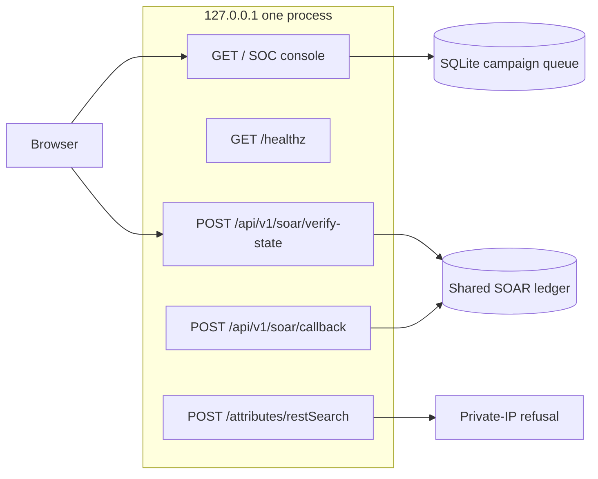

# ThreatFusion

ThreatFusion is a local analyst console for recorded network flows. A frozen Random Forest decides whether a flow is an attack. A person approves any response. The autoencoder does not change that decision.

This repository is a bounded lab prototype. It is not a deployed enterprise SOC, and it does not claim a live SIEM, a finished human study, or a signed jury rubric.

## Architecture

One process on `127.0.0.1` serves the browser page and the MISP / TheHive / n8n contract routes. `scripts/run_live_product.sh` starts that process, waits until both `GET /` and `GET /healthz` answer, and stops it on Ctrl-C or `SIGTERM`.



```text
Recorded flow or Suricata record
  -> strict 14-feature check
  -> frozen Random Forest (sole alert authority)
  -> SQLite campaign queue
  -> analyst stitch of Attack rows that share a verified entity key
  -> local MITRE answer and private-IP refusal
  -> Acknowledge / Escalate / Dismiss, then a grounded handoff
  -> hash-chained approval on the shared ledger
  -> signed verify-state, 4-block TheHive case, HMAC callback
```

The launcher points `THREATFUSION_SOAR_LEDGER_DB_PATH` at `threatfusion-live-soar.sqlite3` beside the console database, unless that variable is already set. Approval, verify-state, and the callback then read the same file. A missing ledger still fails closed.

## What the console does on this branch

| Step | Route | What is stored |
|---|---|---|
| Ingest or replay | `POST /api/v1/live/ingest`, `POST /api/v1/live/replay` | 14-feature flow scored by the frozen Random Forest |
| Approve | `POST /api/v1/live/soar/approve` | Hash-chained `approved` row. Containment stays unauthorized |
| Dispatch | `POST /api/v1/live/soar/dispatch` | Verify-state, a 4-block case, and the HMAC-SHA256 callback MTTR |
| Stitch | `POST /api/v1/live/correlate` | `IncidentCorrelationEngine` on stored Attack rows (30.0s burst / 600.0s campaign) |
| Private IP | `POST /api/v1/live/misp-guard` and `POST /attributes/restSearch` | HTTP 422 for a private, loopback, or link-local address |
| Triage | `POST /api/v1/live/triage` | Acknowledge, Escalate, or Dismiss on the flow |
| Handoff | `POST /api/v1/live/handoff` | 4-block brief kept only when `verify_explanation_groundedness()` passes |

Open pull requests [#2](https://github.com/bilaldevsec/Threatfusion/pull/2), [#3](https://github.com/bilaldevsec/Threatfusion/pull/3), and [#4](https://github.com/bilaldevsec/Threatfusion/pull/4) are not merged here. They add a server-side ledger fallback when the launcher variable is unset, automatic stitch on ingest and replay, a member timeline in the Attack Timeline tab, and triage history inside the handoff packet. This branch still stitches when the analyst presses Stitch, writes one triage row per action, and keeps block 3 `unavailable` when no technique was retrieved.

## Section 8

January validation has 216,568 rows. The frozen Random Forest counts are TP 4,045, FP 201, TN 212,009, FN 313.

```text
attacks            = 4,045 + 313 = 4,358
recall             = 4,045 / 4,358 = 92.818%
precision          = 4,045 / (4,045 + 201) = 95.266%

OR-fusion          = those counts plus 96 attacks and 1,574 false alarms
fused recall       = (4,045 + 96) / 4,358 = 95.021%
recall gain        = 95.021 - 92.818 = 2.203 percentage points
relative TP gain   = 96 / 4,045 = 2.373%
false alarms       = 201 + 1,574 = 1,775
FP multiplier      = 1,775 / 201 = 8.8308x
FP per extra attack = 1,574 / 96 = 16.3958
fused precision    = 4,141 / (4,141 + 1,775) = 69.997%
```

That is a +2.203 pp recall gain (92.818% -> 95.021%; +2.373% relative TP increase, 96/4,045). `production_fusion_enabled` stays false. The four frozen model digests stay unchanged.

| Model | Role | SHA-256 |
|---|---|---|
| Random Forest | sole alert authority | `bd2853a6f9d7f65038cc8bd2da282a2221cb73bda1f1e4c1c714098e8bfcffa9` |
| Logistic regression | linear baseline | `2cf4de6686d937c485d4dbcbfa21d3e90f65bbb922087c8b31be4b012d7fb148` |
| Autoencoder v2 | unfused advisory | `c8675d13869308babf41f269f9437d083daf827781293357e1749d4df0af4b23` |
| Rate-log1p candidate | blocked baseline | `1d02e5bba556cb28709bd0faefce5f29da424a419a2d95332ad27a8995b26f63` |

## Quickstart

From the repository root, with `threatfusion-venv` installed:

```bash
scripts/run_live_product.sh --dry-run
scripts/run_live_product.sh
```

Dry-run checks the interpreter, the console files, the lab secret lengths, and that the port is free. It does not bind. The default listen address is `http://127.0.0.1:8766/`. Set `PORT` or pass `--port` to choose another port.

```bash
scripts/run_live_product.sh --smoke
```

Smoke starts both surfaces, requires HTTP 200 from the page and from `/healthz`, then shuts the process down and checks that the port is free.

Stop a running launcher with Ctrl-C. `SIGTERM` to the launcher stops the child the same way. A busy port, a secret shorter than 16 characters, a missing interpreter, or a missing console file exits with `error:` on stderr and does not leave a listener behind.

Replay scores the recorded study vectors. Approve writes the hash chain on the shared ledger. Dispatch sends verify-state and the HMAC callback. A private address such as `10.0.0.4` is refused before any external lookup.

The script's HMAC and MISP values are lab defaults. Replace them before any shared deployment. Host containment stays unauthorized.

## Still open

TF-008, TF-009, TF-010, and TF-011 remain open. Scores on unseen traffic, a human cohort of at least 10, a signed jury form, and a live feed are not done.
