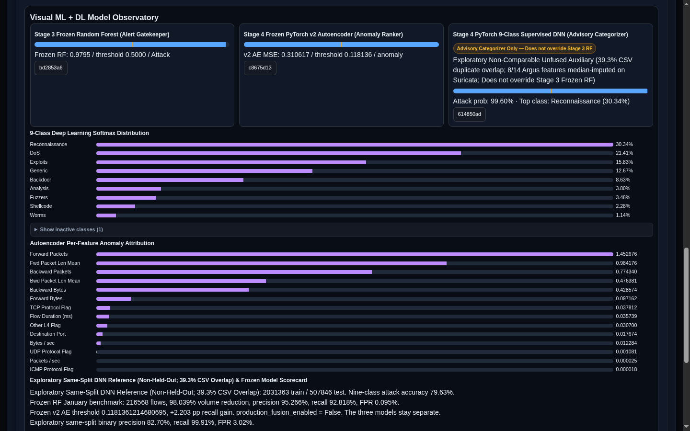
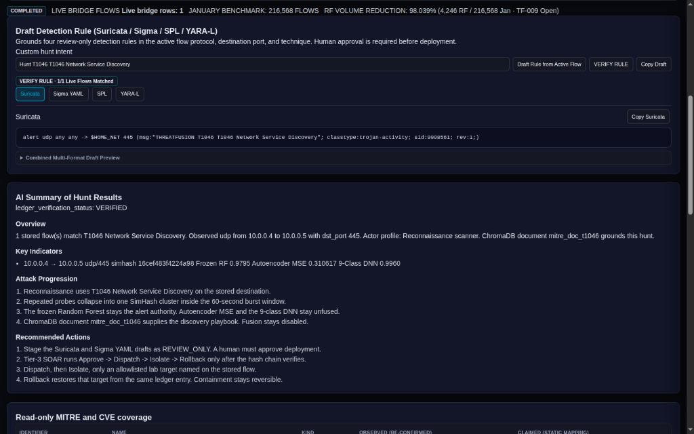
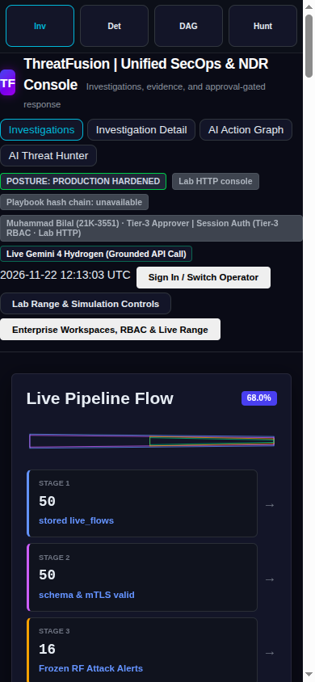

# ThreatFusion (`v1.1.0`) — Deterministic AI Triage & Detection-Engineering Sidecar for Suricata/SOC Teams

**ThreatFusion** is an approval-gated SecOps and Network Detection & Response (NDR) sidecar that pairs a frozen, deterministic Random Forest packet/flow classifier with tamper-evident SOAR audit chaining, grounded RAG threat-intelligence enrichment, and multi-format detection rule drafting (`Suricata`, `Sigma YAML`, `SPL`, `YARA-L`).

> [!IMPORTANT]
> **Scientific & Governance Posture (`PROTOTYPE_CONTROLS_VERIFIED / PRODUCTION_NO_GO`)**
> - **Sole Alert Authority**: Stage 3 Frozen Random Forest (`bd2853a6`) drives every alert decision (`threshold = 0.5000`).
> - **Section 8 Fusion Shield**: `production_fusion_enabled = False` is strictly enforced (raising `ValueError` if toggled).
> - **Gate `G9` Isolation**: Zero LLM, ChromaDB RAG, or advisory imports exist in deterministic pipeline Stages 1–4 or Stage 6 SOAR ledger (`verify_gate_g9()` PASS).
> - **Open Gates**: Formal enterprise/production release stays blocked while all 10 governance gates (`TF-002..TF-004`, `TF-006..TF-012`) remain `open` in [`docs/issue_register.md`](docs/issue_register.md).

---

## Cool Obsidian Operator Console (`v1.1.0`)

| Investigations Queue (`1440x900`) | Investigation Detail & ML Observatory (`1440x900`) |
| :---: | :---: |
|  |  |
| Grounded AI Copilot (`1440x900`) | AI Action Graph & SOAR (`1440x900`) |
|  |  |
| AI Threat Hunter (`1440x900`) | Responsive Mobile Console (`390x844`) |
|  |  |

---

> **Prerequisites**: `Python 3.11 · ~4 GB RAM · all 7 frozen model/fixture artifacts included in repo`

## Multi-Cloud & Local Quickstart (`Python 3.11`)

Requires **Python 3.11** (managed via `uv` in `threatfusion-venv`) and works on **macOS, Linux, Docker, BYOH SSH hosts, AWS, GCP, and Azure** without vendor lock-in.

### 1. Local Standalone Console (macOS & Linux — `$0.00` Air-Gapped Default)

```bash
# 1. Create or sync the Python 3.11 environment
uv venv --python 3.11 threatfusion-venv
uv pip install --python threatfusion-venv/bin/python -e ".[dev]"

# 2. Run turnkey console + SOAR/MISP contract surface with seeded demo scenarios
THREATFUSION_OFFLINE_ONLY=1 GEMINI_ENABLED=false ./scripts/run_live_product.sh --seed-demo --port 8766
```

Open `http://127.0.0.1:8766/` in Chrome/Firefox and click any role card in the sign-in gate (use **Tier-3 SOC Approver** for HMAC-chained SOAR playbook preview/approval drills).

### 2. Local Docker Stack (Suricata + n8n + SOAR Sidecar)

```bash
docker compose -f docker/docker-compose.soc-stack.yml up -d
# Optional isolated attacker/victim range containers:
docker compose -f docker/docker-compose.range.yml up -d
```

### 3. Bring Your Own Host (`BYOH` via `--provider ssh` / `generic`)

```bash
export TF_VICTIM_PUBLIC_IP="<VICTIM_HOST_IP>"
export TF_ATTACKER_PUBLIC_IP="<ATTACKER_HOST_IP>"
export TF_SSH_IDENTITY="~/.ssh/id_ed25519"
export CLOUD_ADMIN_SSH_CIDR="$(curl -fsS https://api.ipify.org)/32"

./scripts/deploy_cloud_range.sh --provider ssh \
  --victim-host "$TF_VICTIM_PUBLIC_IP" \
  --attacker-host "$TF_ATTACKER_PUBLIC_IP" \
  --deploy-full-stack
```

### 4. Cloud Providers (`AWS`, `GCP`, `Azure`)

All cloud workflows lock port `8766` away from `0.0.0.0/0` (operator access uses an SSH local port forward) and restrict SSH to the caller's `/32` CIDR:

- **AWS (`EC2` + Security Groups)**:
  ```bash
  export AWS_ADMIN_SSH_CIDR="$(curl -fsS https://api.ipify.org)/32"
  ./scripts/deploy_cloud_range.sh --provider aws --auto-ip --provision-range
  ./scripts/deploy_cloud_range.sh --provider aws --auto-ip --deploy-full-stack
  ```
- **GCP (`Compute Engine` + VPC Firewall)**:
  ```bash
  export CLOUD_ADMIN_SSH_CIDR="$(curl -fsS https://api.ipify.org)/32"
  ./scripts/deploy_cloud_range.sh --provider gcp --auto-ip --provision-range
  ./scripts/deploy_cloud_range.sh --provider gcp --auto-ip --deploy-full-stack
  ```
- **Azure (`ARM` / B-Series Range)**:
  ```bash
  AZURE_VM_SIZE=Standard_B2pls_v2 ./scripts/deploy_cloud_range.sh --provider azure --auto-ip --deploy-full-stack
  ```

### v1.1.0 operator surface

- Single-row 52px Cool Obsidian header with collapsible **Health & Governance Drawer** (`/readyz`, SOAR hash chain status, transport posture, UTC clock, advisory provider status).
- High-density **Investigations Queue** (`Flows + Correlated Incidents` summary, collapsed telemetry funnel strip, single-row filter bar, `40px` tabular-nums rows).
- **ML Observatory & Threat Hunter**: explicit advisory categorizer guard on the 9-class DNN, collapsed `< 0.01` softmax classes, human-readable 14-feature AE attributions, and exclusive `Suricata | Sigma YAML | SPL | YARA-L` rule tabs.

---

## Frozen Artifact SHA-256 Registry (7/7 Verified)

All 7 frozen binaries/specs are verified byte-identical by `scripts/audit_repo_truth.py`:

| Component | Artifact Path | SHA-256 Prefix (`Full Digest`) | Governance Status |
| :--- | :--- | :--- | :--- |
| **Frozen Random Forest** | `artifacts/models/network_random_forest/full-network-random-forest-6d69c72-v1/random_forest.joblib` | `bd2853a6` (`bd2853a6f9d7f65038cc8bd2da282a2221cb73bda1f1e4c1c714098e8bfcffa9`) | **Product Inference Authority** |
| **Logistic Regression** | `artifacts/models/network_logistic_baseline/full-network-logistic-5e70ed9-v1/logistic_regression.joblib` | `2cf4de66` (`2cf4de6686d937c485d4dbcbfa21d3e90f65bbb922087c8b31be4b012d7fb148`) | Linear Comparator Baseline |
| **Frozen v2 Autoencoder** | `artifacts/models/network_autoencoder/full-benign-autoencoder-2a51c94-v2/autoencoder_state.pt` | `c8675d13` (`c8675d13869308babf41f269f9437d083daf827781293357e1749d4df0af4b23`) | Unfused Experimental Ranker |
| **Rate-Log1p Candidate** | `artifacts/models/network_rate_log1p_autoencoder/rate-log1p-autoencoder-b5e6e5d-v1/autoencoder_state.pt` | `1d02e5bb` (`1d02e5bba556cb28709bd0faefce5f29da424a419a2d95332ad27a8995b26f63`) | `BLOCKED_preserve_baseline` |
| **Preprocessor State** | `data/processed/unsw_network_preprocessing/full-train-only-0141bde-v1/preprocessor_state.json` | `30c955e3` (`30c955e3931dc010f8b4391a80fc0fbeddd17e14260701c8131d88f95b06ee49`) | Frozen 14-Feature Transform |
| **9-Class Supervised DNN** | `artifacts/models/fyp2_dnn_same_split_v1/dnn_model.pt` | `614850ad` (`614850ad84fc4ab32dc6e6d2318900668d97cad6edba37290ed9fe2b2482df1f`) | **Exploratory Non-Comparable Unfused Auxiliary** (39.3% CSV duplicate overlap; 8/14 Argus features median-imputed on Suricata; Does not override Stage 3 Frozen RF) |
| **Calibrated Runtime Fixtures** | `artifacts/benchmarks/unsw_nb15_calibrated_runtime_fixtures.json` | `0c38310e` (`0c38310e84c6869947cc60118a3e2dec91577757c81aded654757ea7ecabcaf6`) | Pinned Study Replay Fixtures |

---

## Scientific Evaluation & Cross-Source Honesty Matrix

| Evaluation Split / Model | Sample Count | Precision | Recall | F1 Score | FPR | Accuracy / Notes |
| :--- | :--- | :--- | :--- | :--- | :--- | :--- |
| **UNSW-NB15 January Validation — Frozen RF (`bd2853a6`)** | `216,568` (`4,358` GT attacks; `4,246` RF predicted alerts) | `95.266%` | `92.818%` | `94.026%` | `0.095%` (`201 / 212,210`) | `99.763%` Accuracy; `98.039%` alert volume reduction (`4,246 / 216,568`) |
| **UNSW-NB15 January Validation — Frozen v2 AE (`c8675d13`)** | `216,568` (`threshold = 0.1181361214680695`) | `54.975%` | `45.617%` | `49.859%` | `0.767%` (`1,628 / 212,210`) | `98.154%` Accuracy; strict `>` threshold comparison; unfused |
| **Section 8 Counterfactual Fusion (RF OR v2 AE)** | `216,568` | `70.00%` | `95.021%` | `80.60%` | `0.836%` | **Blocked (`production_fusion_enabled = False`)**: `+2.203 pp recall gain (92.818% -> 95.021%; +2.373% relative TP increase, 96/4,045)` costs `1,574` extra benign FPs (`8.8308x` inflation, `16.3958` FPs/extra TP) |
| **UNSW-NB15 February Benchmark — Frozen RF** | `1,452,844` rows (exposed under `TF-007`) | `95.675%` | `97.354%` | `96.507%` | **`1.141%`** (`13,163 / 1,153,776`) | Development-informing benchmark (`TF-007` open; not independent held-out proof) |
| **CSE-CIC-IDS2018 Cross-Source — Frozen RF** | `2,097,145` accepted rows | `0.696%` | `0.444%` | **`0.542%`** (`0.54%`) | `16.498%` | `BLOCKED_SEMANTIC_MISMATCH`: byte-layer & extractor semantics fail cross-source transfer (`TF-002`, `TF-003`, `TF-012`) |
| **Exploratory 9-Class DNN (`614850ad`)** | `2,031,363` train / `507,846` test | — | — | — | — | `79.63%` (`0.796318`) nine-class attack accuracy; Exploratory Non-Comparable Unfused Auxiliary (`TF-006`, `TF-012`) |

---

## Open Governance Gates (`docs/issue_register.md`)

All 10 gates below remain honestly **`open`** until verified empirical evidence satisfies their documented closure criteria:

| Gate ID | Area | Summary of Remaining Blocker |
| :--- | :--- | :--- |
| `TF-002` | Cross-Source Qualification | CSE-CIC-IDS2018 semantic mismatch (`0.54%` F1); no validated compatible external test corpus |
| `TF-003` | Extractor Comparability | Unresolved Argus vs CICFlowMeter / live Suricata byte-layer comparability |
| `TF-004` | Host Anomaly Corpus | No representative benign host training corpus; synthetic lab only |
| `TF-006` | CSV Duplicate / Label Overlap | Exact feature collisions (`39.3%` CSV duplicate overlap) & label noise in UNSW CSVs |
| `TF-007` | Evaluation Exposure | February UNSW & CIC outcomes are known and inform design |
| `TF-008` | Independent Model Benchmark | No fresh unseen independent production traffic benchmark beyond inspected Jan/Feb splits |
| `TF-009` | Operational Workload Study | Real SOC analyst workload & MTTR reduction remain unmeasured (`est_mttr_reduction_pct = None`) |
| `TF-010` | Signed External Rubric | External supervisor/jury rubric attachment remains pending (`tf010_signed_rubric_attached = False`) |
| `TF-011` | Production SIEM / TI Proof | End-to-end operational enterprise SIEM & production threat-intel feed proof open |
| `TF-012` | Suricata Feature Mapping | `8/14` Argus features median-imputed or semantically mismatched on live Suricata EVE flows |

---

## Verification & Governance Commands

```bash
# Full test suite (air-gapped default)
GEMINI_ENABLED=false threatfusion-venv/bin/pytest -q

# Boundary preflight (B0-B6) and repository truth audit (Gate G9 + 7/7 SHA-256 digests)
threatfusion-venv/bin/python scripts/boundary_preflight.py --venv threatfusion-venv --json
threatfusion-venv/bin/python scripts/audit_repo_truth.py --json
```

---

<details>
<summary>Academic Provenance & Attribution</summary>

Originated at **FAST-NUCES (National University of Computer and Emerging Sciences)** as project **`AI-FYP-2006`** before commercial productization and multi-cloud hardening in `v1.1.0`. See [`docs/product_charter.md`](docs/product_charter.md), [`docs/project_status.md`](docs/project_status.md), and [`docs/stride_threat_model_and_production_readiness.md`](docs/stride_threat_model_and_production_readiness.md) for full scientific audit history.

</details>
