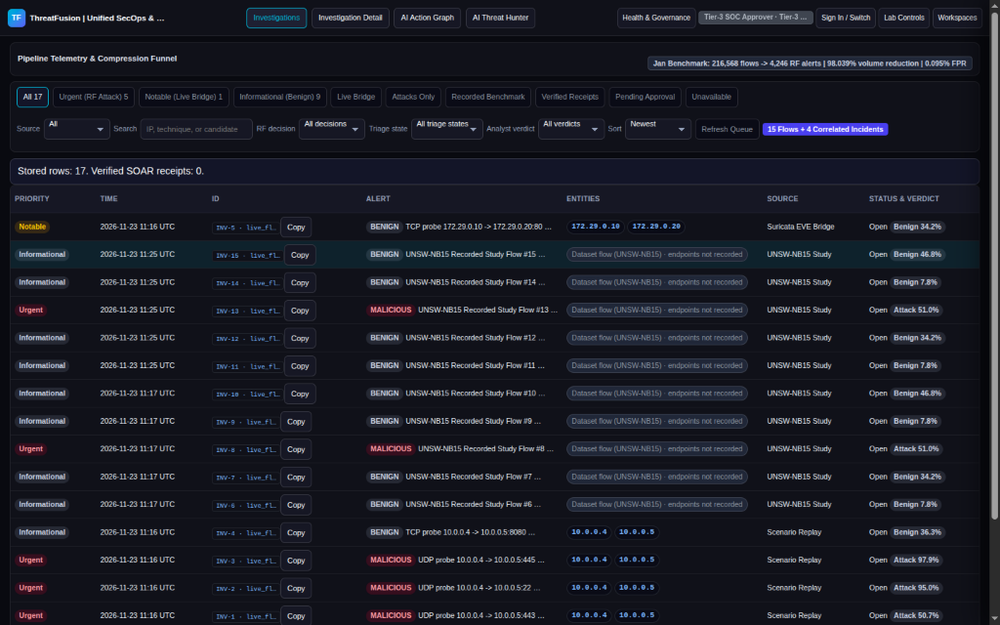
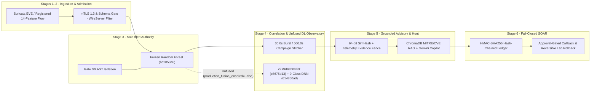
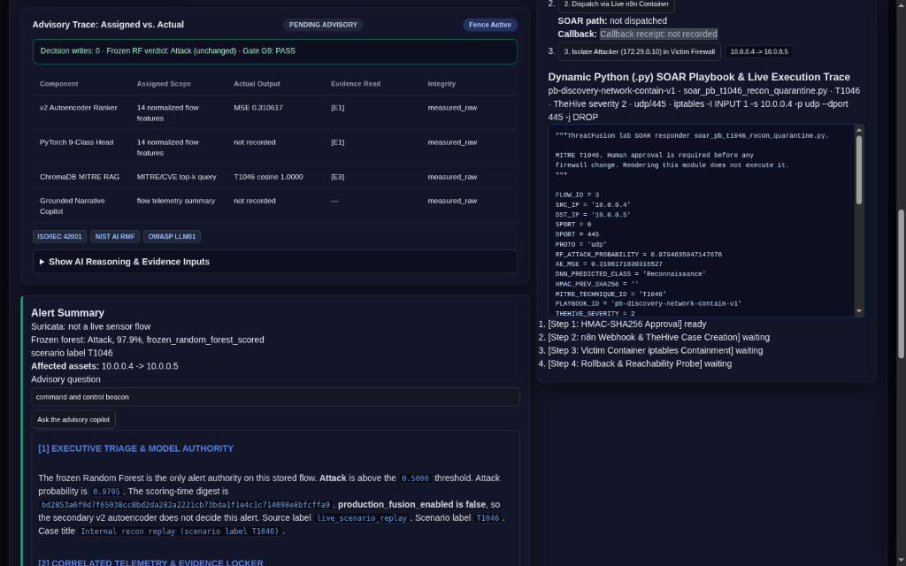
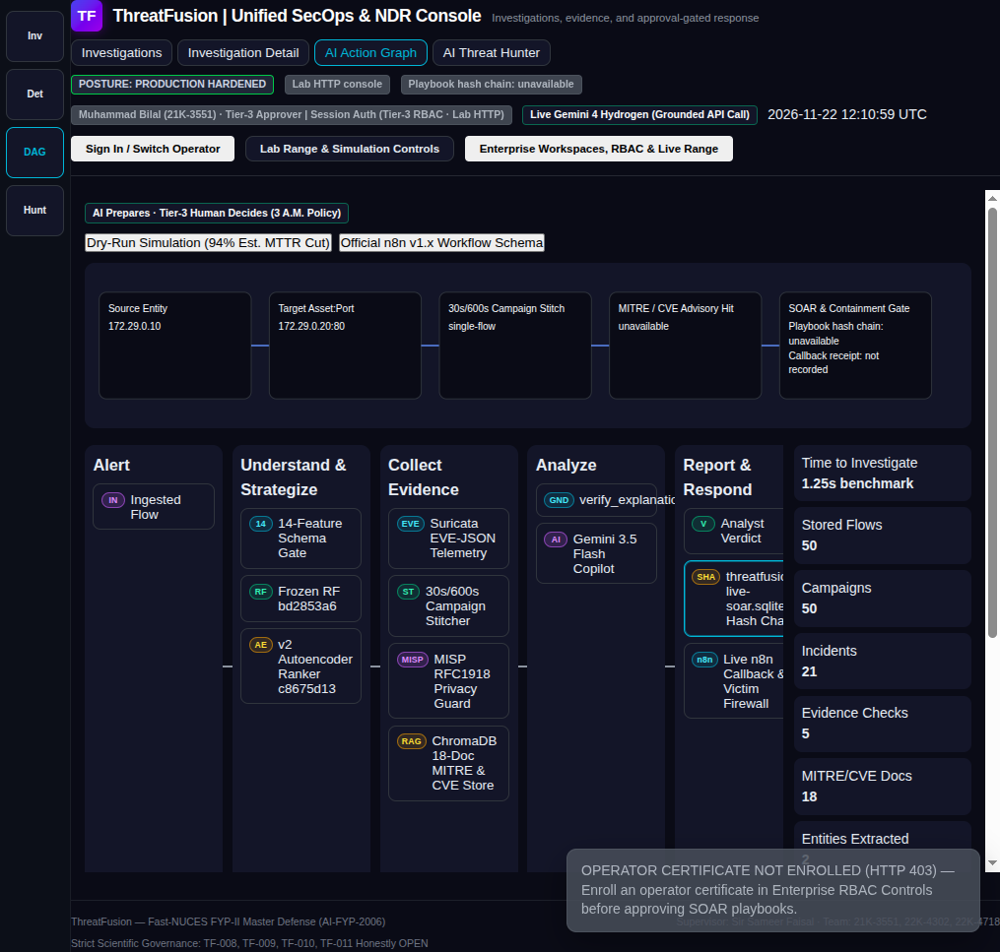

<div align="center">

# 🛡️ ThreatFusion

**Deterministic-First AI Network Detection & Response (NDR) and SecOps Triage Console**

[](https://github.com/bilaldevsec/Threatfusion/actions/workflows/backend-quality.yml)
[](https://github.com/bilaldevsec/Threatfusion/releases/tag/v1.1.0)
[](https://www.python.org/)
[](https://ubuntu.com/)
[](#6-stage-deterministic-architecture--gate-g9)
[](LICENSE)

*Cryptographically pinned ML detection at the core · Fail-closed mTLS/HMAC SOAR execution · Grounded, zero-authority AI copilot.*

[Architecture](#6-stage-deterministic-architecture--gate-g9) · [Live Product Tour](#live-product-tour) · [Benchmarks & Guarantees](#verified-benchmarks--security-guarantees) · [Quickstart](#quickstart) · [MCP & Telemetry Shield](#telemetry-shield--read-only-mcp-server) · [Enterprise Prerequisites](#enterprise-deployment-prerequisites)

</div>

---

ThreatFusion is a deterministic-first NDR and SOC triage platform built to cut analyst alert fatigue without surrendering alert authority to probabilistic LLMs or uncalibrated anomaly detectors. Every network flow is scored exclusively by a SHA-256-verified frozen Random Forest (`bd2853a6`), correlated across `30.0s` burst and `600.0s` campaign windows, explained by a fenced Gemini/local copilot with `0` decision-write capability, and gated behind fail-closed RBAC + client-certificate mTLS + HMAC-SHA256 SOAR approval chains.


*Live Azure Suricata EVE bridge triage queue (`1440×900` dark mode) showing Stage 1→4 pipeline compression, SimHash deduplication, and zero Azure WireServer (`168.63.129.16`) noise.*

---

## 6-Stage Deterministic Architecture & Gate `G9`

Stages 1 through 4 execute with **zero LLM imports** (`Gate G9: PASS`). Deep-learning anomaly scores (v2 Autoencoder) and 9-class attack categorization run in a strictly unfused observatory (`production_fusion_enabled = False`), while Stage 5 advisory reasoning and Stage 6 response remain cryptographically isolated from alert verdicts.



### Gate `G9` & Boundary Preflight (`B0–B6`)

- **Zero LLM Imports in Detection (Stages 1–4):** AST import-graph verification (`scripts/audit_repo_truth.py`) guarantees advisory modules (`threatfusion.advisory.*`) and MCP handlers have `0` write paths to `live_flows` decisions or frozen RF scores.
- **Deterministic Boundary Preflight (`B0–B6`):** `scripts/boundary_preflight.py` enforces workspace non-overlap (`B0`), CWD containment (`B1`), symlink escape checks (`B2`), virtualenv isolation (`B3`), `.git` metadata isolation (`B4`), config non-leakage (`B5`), and `PYTHONPATH`/`sys.path` isolation (`B6`).

---

## Live Product Tour

Captured directly from a live 2-VM Azure cyber range (`Standard_B2pls_v2`, Ubuntu 24.04 LTS ARM64, Python 3.12, Suricata on `eth0`) under real unseen multi-stage attacker traffic (`172.29.0.10 → 172.29.0.20`).

### 1. Visual ML + DL Observatory (`Investigation Detail`)


*Frozen Random Forest (`0.5857` Attack, `bd2853a6`) stays sole alert authority alongside unfused PyTorch v2 Autoencoder (`0.071569` MSE vs `0.118136` threshold) 14-feature residual attribution and 9-Class DNN softmax distribution.*

### 2. Grounded Gemini Copilot & Telemetry Evidence Fence


*Live Gemini advisory grounded in `<untrusted_telemetry_envelope>` (`envelope_sha256: c3a6e6bf...`) with `ISO/IEC 42001` / `NIST AI RMF` / `OWASP LLM01` governance controls, `0` `[UNGROUNDED]` flags, `Decision writes: 0`, and poll-persistent evidence expansion.*

### 3. AI Action Graph & Fail-Closed SOAR Refusal


*5-column investigation DAG (`Alert → Understand → Collect → Analyze → Report & Respond`) demonstrating fail-closed `HTTP 403` (`operator_not_enrolled`) refusal on plain HTTP without an enrolled client mTLS certificate.*

### 4. Detection Engineering (`AI Threat Hunter`)


*Read-only (`mode=ro`) SQLite rule verification (`VERIFY RULE · 7/108 Live Flows Matched`) drafting review-only **Suricata**, **Sigma YAML**, **SPL**, and **YARA-L** detections with clipboard toast feedback and zero DB mutation.*

> Responsive layouts also verify at `390×844` mobile viewports with zero horizontal page overflow ([`06-mobile-console.png`](docs/assets/screenshots/06-mobile-console.png)).

---

## Verified Benchmarks & Security Guarantees

Evaluated on the registered **January UNSW-NB15 validation split (`216,568` flows: `4,358` attacks, `212,210` benign)** with frozen artifacts (`TP=4,045`, `FP=201`, `TN=212,009`, `FN=313`).

| Metric / Guarantee | Verified Result | Scientific & Governance Boundary |
|---|---|---|
| **Frozen RF Precision / Recall** | **`95.266%`** precision · **`92.818%`** recall (`F1 94.026%`) | Sole alert authority (`P(Attack) >= 0.5000`); development-informed validation |
| **Frozen RF False Positive Rate** | **`0.095%`** (`201 / 212,210` benign flows) | `98.0%` raw-to-alert volume reduction on Jan split |
| **AE Observatory (`c8675d13`)** | Threshold `0.1181361214680695` (`14-8-3-8-14`) | Unfused (`production_fusion_enabled = False`); adds `+2.203 pp` recall at `1,574` extra FPs |
| **Stage 1–4 LLM Coupling** | **`0` LLM imports** · **`0` decision writes** | Enforced by Gate `G9` AST check & runtime provenance trace |
| **SOAR & Containment Security** | Fail-closed **mTLS + RBAC + HMAC-SHA256** ledger | Plain-HTTP approval refuses `403`; tampered ledger refuses `409`; containment stays off by default |
| **Automated Verification** | **`1,740+` pytest cases** (`0` failed) · **`7/7` Repo Truth `GO`** · **`B0–B6` `GO`** | Verified across unit, API, mTLS, SOAR ledger, AST gate, and JS DOM suites |

*Fusion disposition:* Combining RF with the v2 autoencoder achieves a +2.203 pp recall gain (92.818% -> 95.021%; +2.373% relative TP increase, 96/4,045), but costs 1,574 additional false positives (`1,775` total FPs, `69.997%` precision). Therefore `production_fusion_enabled = False` remains enforced across all product paths.

### Cryptographically Pinned Model Registry

| Model | Role | SHA-256 Digest |
|---|---|---|
| **Random Forest** | Sole alert authority | `bd2853a6f9d7f65038cc8bd2da282a2221cb73bda1f1e4c1c714098e8bfcffa9` |
| **Logistic Regression** | Linear baseline | `2cf4de6686d937c485d4dbcbfa21d3e90f65bbb922087c8b31be4b012d7fb148` |
| **Autoencoder v2** | Unfused anomaly ranker | `c8675d13869308babf41f269f9437d083daf827781293357e1749d4df0af4b23` |
| **9-Class DNN** | Multi-class observatory | `614850ad84fc4ab32dc6e6d2318900668d97cad6edba37290ed9fe2b2482df1f` |
| **Rate-log1p Candidate** | `BLOCKED_preserve_baseline` | `1d02e5bba556cb28709bd0faefce5f29da424a419a2d95332ad27a8995b26f63` |

---

## Quickstart

### 1. Local Workstation Setup & Demo Console

```bash
uv python install 3.11
uv venv threatfusion-venv --python 3.11
UV_PROJECT_ENVIRONMENT=threatfusion-venv uv sync --locked --dev

# Launch local console with seeded benchmark & range scenarios at http://127.0.0.1:8766/
./scripts/run_live_product.sh --seed-demo
```

For local containerized attacker/victim simulation (no cloud account required):

```bash
./scripts/run_full_range_demo.sh --up
./scripts/run_full_range_demo.sh --scan
./scripts/run_full_range_demo.sh --down
```

### 2. One-Command Live Azure Cyber Range (`Ubuntu 24.04 LTS` · Python 3.12)

Provisions a private `172.29.0.0/24` 2-VM cyber range in `southeastasia` (`tf-soc-victim-vm` + `tf-attacker-redteam-vm`), locks SSH to your operator `/32` IP, deploys Docker Compose (`ChromaDB`, `MISP contract`, `n8n`, `callback`), installs `Suricata` + `threatfusion-eve-follower.service`, verifies `/readyz` (`HTTP 200`), and binds an SSH local tunnel to `http://127.0.0.1:8766/`:

```bash
AZURE_VM_SIZE=Standard_B2pls_v2 ./scripts/deploy_cloud_range.sh --auto-ip --deploy-full-stack
```

**Mandatory `$0.00` Idle-Burn Teardown:**

```bash
./scripts/deploy_cloud_range.sh --teardown
az group exists --name ThreatFusion-RG   # returns: false
```

---

## Telemetry Shield & Read-Only MCP Server

- **Telemetry Evidence Fence (`backend/src/threatfusion/advisory/telemetry_shield.py`):** Compresses burst telemetry via 64-bit SimHash (`BURST_WINDOW_SECONDS = 60.0`), sanitizes control characters, wraps untrusted network fields inside `<untrusted_telemetry_envelope>` tags, and cross-checks advisory claims against the HMAC-SHA256 ledger.
- **Read-Only MCP Server (`scripts/threatfusion_mcp_server.py`):** Exposes `threatfusion_list_queue`, `threatfusion_get_incident`, `threatfusion_get_advisory_trace`, and `threatfusion_draft_detection_rule` over JSON-RPC 2.0 stdio while hard-blocking `approve`, `dispatch`, `isolate`, `rollback`, and `contain`.

### v1.2 operator surface

| Surface | Capability & Fail-Closed Guardrail |
|---|---|
| **Queue & Funnel** | 12s non-overlapping poll, manual `Refresh Queue`, SimHash burst clusters, envelope compaction metrics, and Azure WireServer/IMDS noise filtering |
| **Investigations** | Patient Zero asset scope, 30s/600s correlation timeline, Frozen RF + unfused AE/DNN observatory, and decomposed CTI |
| **AI Threat Hunter** | Five hunting guides (`T1046`, `T1110`, `T1190`, `T1498`, `INV-4`), read-only `mode=ro` SQLite `VERIFY RULE`, and quad-format **Suricata / Sigma YAML / SPL / YARA-L** drafts |
| **SOAR / Action Graph** | 5-column DAG, `3 A.M.` policy (`AI prepares, human decides`), n8n v1.x schema preview, and mTLS/HMAC-gated execution |

---

## Verification & Governance Gates

```bash
# 1. Boundary Preflight (B0–B6)
./threatfusion-venv/bin/python3 scripts/boundary_preflight.py --venv threatfusion-venv --json

# 2. Deterministic Repository Truth Audit (7/7 GO)
./threatfusion-venv/bin/python3 scripts/audit_repo_truth.py --json

# 3. Full Test Suite (offline-safe, Gemini disabled)
env -u PYTHONPATH PYTHONDONTWRITEBYTECODE=1 GEMINI_ENABLED=false \
  ./threatfusion-venv/bin/pytest -q -o cache_dir=/tmp/.pytest_cache
```

---

## Enterprise Deployment Prerequisites

ThreatFusion enforces strict scientific and operational honesty before claiming production readiness. Accordingly, `TF-008, TF-009, TF-010, and TF-011 remain open.` as formal enterprise integration prerequisites:

- **TF-008 — Independent External Holdout Benchmark:** Formal pre-registered evaluation on an untouched external dataset beyond inspected UNSW-NB15 splits.
- **TF-009 — Human-Factors Analyst Cohort Study:** Controlled measurement (`min_human_trials >= 10`) comparing raw SIEM triage vs. ThreatFusion enriched triage.
- **TF-010 — External Signed Jury / Compliance Rubric:** Formal attachment of the signed external review rubric (`AI-FYP-2006`).
- **TF-011 — Live Enterprise SIEM & Production TI Feeds:** End-to-end production SIEM and authenticated commercial/community threat-intelligence stream ingestion beyond bounded range deployments.

---

<details>
<summary><strong>Credits & Academic Origin</strong></summary>

Developed at **FAST-NUCES Karachi** — CS492 Final Year Project (`AI-FYP-2006`).
**Team:** Muhammad Bilal (`21K-3551`), Muhammad Suhaib Shaikh (`22K-4302`), Muhammad Hasnain (`22K-4718`) · **Supervisor:** Sir Sameer Faisal.

</details>
