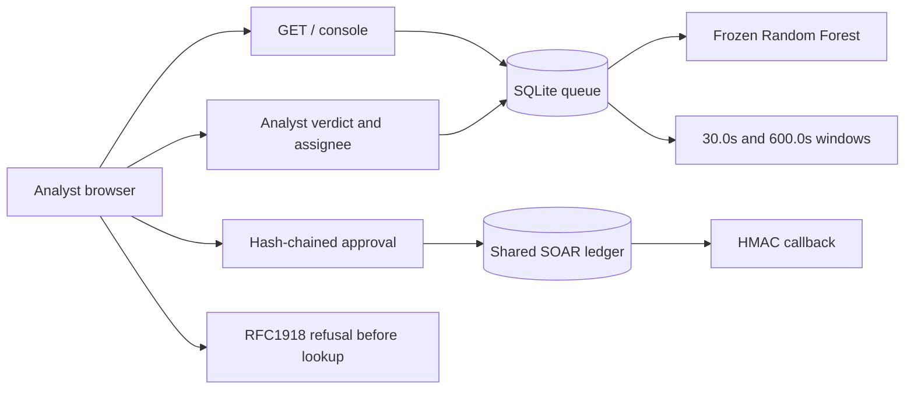

# ThreatFusion

ThreatFusion is a local security operations console. A frozen Random Forest is the only alert authority. Analysts record a separate verdict, assign a case, and approve a response. The autoencoder does not change the alert decision. Host containment stays unauthorized.

## Architecture

One process on `127.0.0.1` serves the console and the contract routes. `scripts/run_live_product.sh` starts that process, waits for `GET /` and `GET /healthz`, and stops it on Ctrl-C or `SIGTERM`.



```text
Recorded 14-feature flow
  -> frozen Random Forest decision
  -> SQLite queue with live counts
  -> analyst verdict, rationale, assignee, and review status
  -> glass-box checklist from stored fields
  -> correlation of Attack rows that share a verified entity key
  -> grounded shift handoff
  -> hash-chained approval, verify-state, and HMAC callback
```

Approval, verify-state, and the callback share one ledger file. A missing ledger fails closed.

## Quickstart

From the repository root, with `threatfusion-venv` installed:

```bash
./scripts/run_live_product.sh --seed-demo
```

Open `http://127.0.0.1:8766/`. `--seed-demo` stores four labeled scenarios and keeps serving. `--dry-run` checks the interpreter, the console files, the lab secret lengths, and a free port without binding. `--smoke` requires HTTP 200 from the page and from `/healthz`, then stops and checks that the port is free.

The lab HMAC and MISP values are not production credentials. Replace them before any shared deployment.

## Analyst workflow

| Action | Route | What is stored |
|---|---|---|
| Ingest or replay | `POST /api/v1/live/ingest`, `POST /api/v1/live/replay`, `POST /api/v1/live/scenarios` | 14-feature flow scored by the frozen Random Forest |
| Live sensor | `POST /api/v1/live/sensor` | One Suricata bridge flow. The observation line and the forest score stay separate |
| Verdict | `POST /api/v1/live/verdict` | `true_positive`, `false_positive`, or `inconclusive`, with a grounded rationale, beside the forest decision |
| Assignment | `POST /api/v1/live/assignment` | Local assignee and `unassigned`, `in_review`, or `reviewed` |
| Triage | `POST /api/v1/live/triage` | Acknowledge, escalate, or dismiss |
| Handoff | `POST /api/v1/live/handoff` | Four blocks plus the verdict, assignee, and review status, only when the note stays inside stored evidence |
| Approve | `POST /api/v1/live/soar/approve` | Hash-chained approval. Containment stays unauthorized |
| Dispatch | `POST /api/v1/live/soar/dispatch` | Verify-state, a four-block case, and the HMAC-SHA256 callback |
| Stitch | `POST /api/v1/live/correlate` | Attack rows inside the 30.0 second burst window or the 600.0 second campaign window |

The queue searches, filters, and sorts stored rows by source, forest decision, triage state, analyst verdict, and forest probability. Live sensor rows, the recorded UNSW study, and the labeled scenario replay do not share a campaign id. The hero cards show the live SQLite flow, campaign, and incident counts, plus how many stored rows came from the live bridge. The January 216,568-flow figures stay in the Frozen Benchmark Evaluation Baseline.

## Section 8 benchmark

January validation has 216,568 rows. The frozen Random Forest counts are TP 4,045, FP 201, TN 212,009, FN 313.

| Measure | Frozen Random Forest | Fusion candidate |
|---|---|---|
| Rows | 216,568 | same population |
| Recall | 92.818% (4,045 / 4,358) | 95.021% |
| Precision | 95.266% | 69.997% |
| False positives | 201 | 1,775 |
| Extra attacks | — | 96 |
| Extra false alarms | — | 1,574 |

That is a +2.203 pp recall gain (92.818% -> 95.021%; +2.373% relative TP increase, 96/4,045). `production_fusion_enabled` stays false because those 96 extra attacks cost 1,574 extra false alarms.

| Model | Role | SHA-256 |
|---|---|---|
| Random Forest | sole alert authority | `bd2853a6f9d7f65038cc8bd2da282a2221cb73bda1f1e4c1c714098e8bfcffa9` |
| Logistic regression | linear baseline | `2cf4de6686d937c485d4dbcbfa21d3e90f65bbb922087c8b31be4b012d7fb148` |
| Autoencoder v2 | unfused ranker | `c8675d13869308babf41f269f9437d083daf827781293357e1749d4df0af4b23` |
| Rate-log1p candidate | blocked baseline | `1d02e5bba556cb28709bd0faefce5f29da424a419a2d95332ad27a8995b26f63` |

## Security guarantees

- The frozen Random Forest scores a flow only when the artifact digest matches and the input width is 14.
- The analyst verdict, rationale, assignee, and review status are stored separately from that decision.
- A rationale that names an address the flow does not store is refused.
- RFC1918, loopback, link-local, and IPv6 unique-local addresses are refused before any indicator lookup.
- The SOAR ledger is a SHA-256 hash chain. A failed timing write does not report the callback as recorded.
- Host containment is not executed from this console.
- TF-008, TF-009, TF-010, and TF-011 remain open. Scores on unseen traffic, a human cohort of at least 10, a signed jury form, and a live feed are not done.
