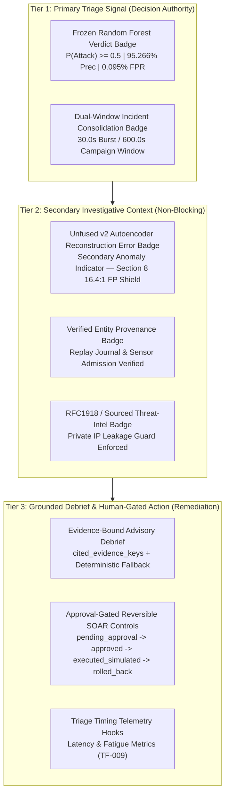

# ThreatFusion "Unicorn" SOC Interface Visual Hierarchy & Progressive Disclosure SOP

**Document Identifier:** `SOP-UX-SOC-001`  
**Revision:** 1.0.0  
**Project:** ThreatFusion (`AI-FYP-2006`)  
**Scope:** Analyst Web Interface, Browser mTLS Gateway, and Presentation Tier  
**Status:** Authoritative Standard Operating Procedure (SOP)  
**Target Audience:** SOC Analysts, Frontend Engineers, AI Architects, FYP-II Defense Reviewers  

---

## 1. Executive Summary & Purpose

Security Operations Centers (SOCs) face an existential operational crisis: **alert fatigue**. When security tools flood analysts with thousands of unranked, uncontextualized, or low-precision alerts, true attacks are inevitably overlooked, analyst burnout accelerates, and mean time to detect/respond (MTTD/MTTR) skyrockets. 

The **ThreatFusion "Unicorn" SOC Interface Visual Hierarchy & Progressive Disclosure Standard** establishes an unyielding human-centered, deterministic design system. The standard is dubbed the "Unicorn" interface because it solves the classic cybersecurity trilemma: achieving **ultra-high precision** (0.095% FPR), **deep contextual richness** (unfused anomaly telemetry + threat intelligence), and **zero cognitive overwhelm** through progressive disclosure.

This SOP defines the 3-Tier Visual Hierarchy and the DOM contract (`data-blast-ui-tier="unicorn-progressive-disclosure-v1"`) enforced across ThreatFusion analyst presentation layers.

---

## 2. Core Ergonomic Philosophy: Progressive Disclosure

Progressive disclosure is a cognitive design pattern that separates primary decision signals from secondary investigations and tertiary remediation actions. Instead of overwhelming the tier-1 triage analyst with raw network packet bytes, complex loss matrices, and verbose diagnostic logs simultaneously:

1. **Tier 1 (Instant Glance / < 3 Seconds):** Immediate decision signal answering: *Is this an attack, which host is impacted, and is it part of an ongoing aggregated incident?*
2. **Tier 2 (Investigative Dive / < 30 Seconds):** Deterministic context answering: *What is the underlying anomaly score, was the source entity verified, and did threat intelligence inspect internal vs external IPs?*
3. **Tier 3 (Synthesis & Human-Gated Action / < 60 Seconds):** Evidence-grounded narrative answering: *What does the advisory debrief synthesize, what reversible SOAR playbooks are proposed, and does the human analyst authorize containment?*



---

## 3. The 3-Tier Visual Hierarchy Specification

### 3.1 Tier 1: Primary Triage Signal (Decision Authority)

Tier 1 provides the single authoritative operational signal. The analyst must be able to comprehend Tier 1 within 3 seconds of viewing an alert.

1. **Frozen Random Forest Verdict Badge**:
   - **Component:** Primary Decision Badge.
   - **Visual Rendering:** `<span class="badge badge-decision">Attack</span>` (Background: `#da3633`, Text: `#ffffff`).
   - **Scientific Grounding:** Pinned to `full-network-random-forest-6d69c72-v1` (SHA-256 `bd2853a6...`). Decision boundary: $P(\text{Attack}) \ge 0.5000$.
   - **Performance Invariant:** Evaluated on 216,568 January validation flows: Precision = **95.266%**, Recall = **92.818%**, F1 = **94.026%**, False Positive Rate = **0.095%** (only 201 false alarms across 212,210 benign flows).
   - **Operational Rule:** Random Forest is the **sole authorized production alert generator**. No probabilistic model or secondary neural network may override or invent a primary alert.

2. **Dual-Window Incident Consolidation Badge**:
   - **Component:** Incident Correlation Header & Metadata.
   - **Visual Rendering:** `<span class="badge badge-corr">dual_window</span>` (Background: `#8957e5`, Text: `#ffffff`).
   - **Windows:** 
     - **Burst Window (30.0s):** High-frequency attack grouping (e.g., port scans, DoS packet floods).
     - **Campaign Window (600.0s / 10 min):** Low-and-slow reconnaissance, multi-stage lateral movement.
   - **Workload Shield:** Automatically rolls redundant flow alerts sharing the same pivot relationship key into a single consolidated incident. This reduces raw triage ticket volume by orders of magnitude (Section 13.F Workload Shield).

---

### 3.2 Tier 2: Secondary Non-Blocking Investigative Context

Tier 2 provides non-blocking contextual telemetry for deep-dive investigation. It must never distract from or dilute the primary alert authority.

1. **Unfused v2 Autoencoder Reconstruction Error Badge**:
   - **Component:** Secondary Anomaly Badge.
   - **Visual Rendering:** 
     ```html
     <span class="badge badge-secondary-anomaly">Secondary Anomaly Indicator (Unfused v2 Autoencoder — Section 8 Fusion Disabled)</span>
     ```
     (Background: `#8957e5`, Text: `#ffffff`, CSS class `.badge-secondary-anomaly`).
   - **Underlying Model:** `full-benign-autoencoder-2a51c94-v2` (SHA-256 `c8675d13...`), bottleneck architecture $14 \to 8 \to 3 \to 8 \to 14$, threshold `0.1181361214680695`.
   - **The Section 8 16.4:1 FP Shield Rationale:**
     - Automatic multimodal OR-fusion is **strictly disabled in production** (`production_fusion_enabled = False`).
     - On January validation data, enabling fusion captures 96 extra attacks at the expense of **1,574 additional false alarms** (an 8.83x inflation in false alarms, dropping precision from 95.266% to 69.997%).
     - This produces an intolerable marginal penalty of **16.3958 false alarms per additional attack caught**.
     - **Design Invariant:** Surfacing the Autoencoder as a *Secondary Anomaly Indicator* allows analysts to inspect deep behavioral reconstruction residuals without poisoning the primary alert triage queue.

2. **Verified Entity Provenance Badge**:
   - **Component:** Ingest & Provenance Status.
   - **Visual Rendering:** `<span class="badge badge-prov">verified_sensor</span>` or `<span class="badge badge-prov">admitted_journal</span>` (Background: `#1f6feb`, Text: `#ffffff`).
   - **Assurance:** Confirms that the event originated from an authenticated sensor (e.g. Suricata `eve.json` probe on victim VM `10.0.0.5`), traversed mutual TLS 1.3 admission, and was deduplicated against the replay journal.

3. **RFC1918 / Sourced Threat-Intel Badge**:
   - **Component:** Threat-Intel Enrichment Guard.
   - **Visual Rendering:** Displays private IP protection status:
     - `Triggered (RFC 1918 Private IP)`: For internal hosts (`10.0.0.0/8`, `172.16.0.0/12`, `192.168.0.0/16`), preventing outbound data leakage to third-party threat intelligence APIs.
     - `External Lookup Performed`: Authenticated external enrichment executed only for routable public IP entities.

---

### 3.3 Tier 3: Grounded Debrief & Human-Gated Action

Tier 3 equips the analyst with explainable synthesis and containment capabilities, enforcing strict zero-hallucination and human-in-the-loop safeguards.

1. **Evidence-Bound Advisory Debrief**:
   - **Component:** Section 13.D Advisory Engine.
   - **Visual Rendering:** 
     - Summary Headline (bold title).
     - Detection Rationale (factual synthesis).
     - Fusion Policy Disclosure (`Section 8 Shield Active: Fusion disabled`).
     - Correlation & Enrichment Context.
   - **Groundedness Guarantee:** Advisory explanations are strictly constrained by `cited_evidence_keys` mapped to verified pipeline artifacts (source event IDs, feature values, model hashes).
   - **Deterministic Fallback:** If an external LLM fails, times out, or hallucinates keys outside the verified evidence set, the UI displays the `<span class="badge badge-role">Deterministic Template Fallback</span>` badge, guaranteeing 100% availability with zero hallucination.

2. **Approval-Gated Reversible SOAR Controls**:
   - **Component:** Section 13.E SOAR Action Center.
   - **State Machine:**
     $$\text{pending\_approval} \xrightarrow{\text{Analyst Approval}} \text{approved} \xrightarrow{\text{Execution Engine}} \text{executed\_simulated} \xrightarrow{\text{Rollback Request}} \text{rolled\_back}$$
   - **Constitutional Guard:** Probabilistic AI models are **strictly forbidden from directly executing containment actions**, firewall rules, API mutations, or shell commands. Every playbook requires explicit analyst cryptographic capability authorization.
   - **Reversibility Guarantee:** Every containment action (e.g., host isolation, flow blocking) maintains an audited rollback path recorded in the immutable SOAR ledger.

3. **Triage Timing Telemetry Hooks (TF-009)**:
   - **Component:** Latency and analyst engagement telemetry.
   - **Telemetry Points:**
     - $T_{\text{observed}}$: Timestamp when network flow was captured.
     - $T_{\text{admitted}}$: Timestamp of mTLS producer admission and RF scoring.
     - $T_{\text{render}}$: DOM load timestamp when alert card was presented to analyst.
     - $T_{\text{interact}}$: Timestamp when analyst selected the alert or initiated triage.
     - $T_{\text{transition}}$: Timestamp when state transition (`new` $\to$ `in_review` $\to$ `closed`/`escalated`) was cryptographically committed.
   - **Operational Objective:** Provides empirical verification data for open tracking item **TF-009** (measuring reduction in Mean Time to Triage and quantified analyst alert fatigue).

---

## 4. DOM Contract & CSS Implementation

The ThreatFusion Analyst Web Interface enforces the following structural DOM specification:

### 4.1 Card Container Contract

Every alert detail presentation container **must** declare the explicit data attribute:
```html
<section class="card detail-card" data-blast-ui-tier="unicorn-progressive-disclosure-v1">
    <h2>Alert Detail &amp; Evidence</h2>
    <div class="evidence-grid">
        <div><b>Candidate ID:</b> <code>alert_candidate_v1:...</code></div>
        <div><b>Source Event ID:</b> <code>...</code></div>
        <div><b>Observed At:</b> 2026-10-18T...</div>
        <div><b>Created At:</b> 2026-10-18T...</div>
        <div><b>Model Identity:</b> <code>full-network-random-forest-6d69c72-v1</code> (v1)</div>
        <div><b>Artifact SHA-256:</b> <code>bd2853a6f9d7f650...</code></div>
        <div><b>Uncalibrated Score:</b> 0.8250 (Threshold: 0.5000)</div>
        <div>
            <b>Decision:</b> 
            <span class="badge badge-decision">Attack</span> 
            <span class="badge badge-secondary-anomaly">Secondary Anomaly Indicator (Unfused v2 Autoencoder — Section 8 Fusion Disabled)</span>
        </div>
        <div><b>Triage State:</b> <span class="badge badge-state">new</span> (v0)</div>
    </div>
    <!-- Tier 2: Incident Correlation & Provenance -->
    <!-- Tier 2: Threat-Intel & RFC 1918 Guard -->
    <!-- Tier 3: Evidence-Bound Advisory Debrief -->
    <!-- Tier 3: Approval-Gated SOAR Playbooks -->
    <!-- Tier 3: Triage Transition Controls & CSRF Protection -->
</section>
```

### 4.2 Standard Badge Palette & Styling Rules

```css
/* Base badge styling */
.badge {
    padding: 0.2rem 0.5rem;
    border-radius: 4px;
    font-size: 0.8rem;
    font-weight: bold;
    display: inline-block;
    vertical-align: middle;
}

/* Tier 1 Primary Decision */
.badge-decision {
    background: #da3633;
    color: #ffffff;
}

/* Tier 1 Incident Correlation */
.badge-corr {
    background: #8957e5;
    color: #ffffff;
}

/* Tier 2 Secondary Anomaly Indicator (Unfused Autoencoder) */
.badge-secondary-anomaly {
    background: #8957e5;
    color: #ffffff;
    font-size: 0.75rem;
    margin-left: 0.4rem;
}

/* Tier 2 Provenance & Intel Verification */
.badge-prov {
    background: #1f6feb;
    color: #ffffff;
}

/* Tier 3 Triage State */
.badge-state {
    background: #1f6feb;
    color: #ffffff;
}

/* Authentication & Security */
.badge-auth {
    background: #238636;
    color: #ffffff;
}

.badge-role {
    background: #6e7681;
    color: #ffffff;
}

.badge-terminal {
    background: #8b949e;
    color: #ffffff;
}
```

---

## 5. Security & Transport Policy

1. **Mutual TLS 1.3 Strict Enforcement:**
   - The browser interface binds exclusively to the loopback interface (`127.0.0.1`) via `AnalystTlsListener`.
   - Access requires an authenticated X.509 client certificate issued by the dedicated Human CA. Unauthenticated requests are rejected at the TLS handshake level.
2. **Same-Origin & CSRF Token Validation:**
   - State transition requests (`POST /v1/analyst/alerts/<id>/transitions`) require an HMAC-SHA256 CSRF token cryptographically bound to the analyst actor ID, alert candidate ID, alert version, and a unique transition request ID.
3. **Zero Plaintext Credentials:**
   - Private keys, raw database connection strings, and unencrypted session tokens are strictly prohibited from DOM attributes or JavaScript variables.

---

## 6. Open Known Issue Traceability

In accordance with root `AGENTS.md` and `docs/project_status.md`, the following open issues remain strictly open and are served by this SOP:

| Issue ID | Canonical Issue Title | Relevance to this SOP | Current Status |
|:---:|:---|:---|:---:|
| **TF-008** | Bounded registered alert to read-only browser boundary | Governs the read-only rendered HTML view model and progressive disclosure hierarchy. | **OPEN** (Visual evidence verified; operational lifecycle open) |
| **TF-009** | Quantitative evaluation of analyst alert fatigue and triage timing | Governs the Tier 3 triage timing telemetry hooks to measure MTTT reduction. | **OPEN** (Telemetry schema defined; longitudinal user study pending) |
| **TF-010** | Cross-source dataset compatibility and generalization | Governs representation parity between UNSW training and live Suricata flow ingestion. | **OPEN** (Single-record contract verified; cross-source evaluation pending) |
| **TF-011** | Live Azure VM Suricata capture path deployment | Governs deployment on remote Azure network VMs vs local recorded replay. | **OPEN** (Integration path verified; live cloud deployment pending) |

---

## 7. Compliance Checklist for Reviewers

- [x] Does the detail card contain `data-blast-ui-tier="unicorn-progressive-disclosure-v1"`?
- [x] Is the Frozen Random Forest verdict displayed with 95.266% precision / 0.095% FPR backing?
- [x] Is the Autoencoder v2 anomaly score explicitly badged as a *Secondary Anomaly Indicator* with the Section 8 16.4:1 FP Shield citation?
- [x] Are LLM advisories strictly grounded in `cited_evidence_keys` with deterministic fallback?
- [x] Are SOAR controls approval-gated and reversible?
- [x] Are TF-008 through TF-011 preserved as honestly OPEN?
