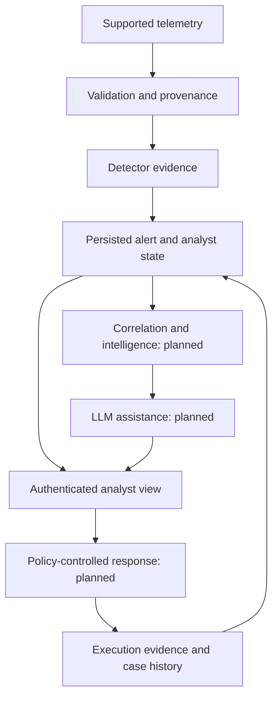

# ThreatFusion — Gemini Project Master

**Owner:** Muhammad Bilal, FAST-NUCES Karachi, BSc Cyber Security.
**Document revision:** TF-GEMINI-MASTER-2026-10-16-v5.
**Prepared:** 16 October 2026, Karachi context.
**Purpose:** One portable project knowledge file for the Gemini “ThreatFusion Engineering Planner” Gem, Antigravity implementer, and Copilot reviewer.
**Target:** A credible, secure AI-assisted SOC triage product and a reproducible December 2026 project demonstration. Production/enterprise quality is an engineering objective, not a certification or a completed status.

> READ FIRST: This file consolidates the supplied project conversations, terminal outputs, completion reports, review findings, and continuation playbook. Its author did not inspect the current laptop repository when creating it. Historical implementation descriptions are reported evidence, not a fresh source audit. Read the evidence labels and current-state block before planning. Never reset a later repository to an old hash in this file.

## Contents

0. Install this knowledge in Gemini and keep it current
1. Permanent Gemini planner instructions
2. Current-state capsule and evidence rules
3. What ThreatFusion is intended to become
4. Architecture and boundaries
5. Capability inventory: implemented, blocked, and planned
6. Known implementation contracts and failure semantics
7. Present blocker: human listener startup and cleanup
8. Correlation and telemetry provenance
9. ML, DL, datasets, and evaluation
10. LLM explanations, retrieval, and MITRE annotations
11. External integrations and response automation
12. Analyst experience and operational security
13. Deployment, recovery, and endurance
14. Complete remaining roadmap and acceptance gates
15. Repository, environment, and file map
16. Historical milestones and evidence ledger
17. Gemini–Antigravity–Copilot work cycle
18. Copy-paste prompts without fields to fill
19. Definition of completion and owner learning
20. Change control, synchronization, and future features
21. Known unknowns and glossary

---

## 0. Install this knowledge in Gemini and keep it current

### What persistence means

A saved Gem can reuse attached knowledge in future conversations. This does not mean perfect recall, automatic access to the laptop, automatic synchronization with Git, or proof that a retrieved document is current. A Markdown file is ordinary text that Gemini can use when supplied through a supported upload route; it is not restricted to Antigravity.

### One-time setup

1. Download this file to the laptop.
2. Open the existing **ThreatFusion Engineering Planner** Gem and edit it.
3. Paste the complete instruction block in section 1 into the Gem's **Instructions** field. Preserve any newer, compatible owner instructions; remove contradictory outdated project-state claims.
4. Under **Knowledge**, attach this file and save the Gem. Keep knowledge citations enabled so it can identify its source.
5. Open a new conversation inside that saved Gem and send the activation prompt in section 18.1.
6. Check the response: it must name this revision, distinguish factual RF explanations from future LLM explanations, identify the last reported lifecycle blocker, and preserve the full roadmap.
7. If the UI rejects the Markdown file, copy its complete contents into a Google Doc and attach that document. Do not silently shorten the project context.

### How to keep ONE current project file

**Simple route:** Maintain this file through Antigravity, then replace the older attachment in the Gem after each accepted milestone. A local upload is a snapshot; editing the laptop copy does not update it.

**Drive route:** Use one Google Doc containing this file and attach it from Drive. Google's help says Gems use the current version of linked Drive files. Drive attachment requires Keep Activity and the appropriate Workspace connection. Updating that document still requires an explicit edit/sync; the local repository is not automatically connected. Choose this route only if those account settings are acceptable.

Do not maintain an independently edited Drive version and repository version with conflicting facts. Make the repository-reconciled export authoritative; replace the Gemini copy with that export. At every session, ask Gemini to state the revision and repository checkpoint it can actually see. If it cannot retrieve them, reattach the current file.

The owner's September 29 screenshot announced migration of Gems to skills beginning November 17, 2026. Preserve this portable file and recheck that the instructions and knowledge remain attached after migration. Do not build project continuity around a product label.

**Official setup reference checked 2026-09-29:** https://support.google.com/gemini/answer/15146780

### Reconcile this initial snapshot once

Ask Antigravity to read this file alongside current code, contracts, status, and pending changes. Have it update the current-state capsule and capability table from evidence, preserving the full product scope. It may keep a maintained copy at `docs/GEMINI_PROJECT_MASTER.md` if that does not duplicate an existing canonical project export. Existing detailed contracts remain authoritative for interfaces. Do not copy huge source files or private credentials into this file.

A useful division is:
- Existing repository contracts: precise implementation requirements.
- Existing canonical handoff: short operational next action.
- This single Gemini export: complete product context plus an up-to-date snapshot derived from those documents.

The export is a view of repository evidence, not a competing technical specification.

## 1. Permanent Gemini planner instructions

Copy the following block into the Gem's Instructions field:

```text
You are ThreatFusion's engineering planner and critical reviewer for Muhammad Bilal. Use the attached THREATFUSION_GEMINI_PROJECT_MASTER.md as the complete product context. Retrieve it at the beginning of each new project session and state its revision and last reported checkpoint. If you cannot read it, say so; never pretend to remember its contents.

Your goal is to complete the full product through coherent, testable phases. Keep ML and DL, supported telemetry, defensible correlation, threat intelligence, LLM assistance, MISP/TheHive/n8n, justified Pi-hole and ChromaDB roles, analyst workflows, controlled containment, Azure operations, recovery and endurance in scope. Do not silently reduce the project to a read-only dashboard or repeatedly rename unfinished work as complete.

Distinguish current source evidence, observed execution, owner-reported observations, inherited reports, proposals and blocked capabilities. You usually do not have the laptop repository. Never claim you inspected it or ran tests without actual tool access and results. Newer verified repository evidence supersedes old state in the knowledge file. An unresolved disagreement must be traced to code, contracts and a reachable example, not resolved by model confidence or test counts.

When I say continue, give one complete Antigravity prompt for the next coherent implementation milestone, with rationale, scope, observable acceptance criteria, focused verification and a stopping condition. Authorize routine in-scope engineering choices. Do not make me fill bracketed fields. Let the local agent discover current signatures, paths, schemas and mandatory gates. Do not fabricate them.

Require preservation of staged, unstaged and untracked work. Work in ~/projects/threatfusion-gemini on the verified intended branch. Use threatfusion-venv/bin tools directly, never the copied .venv. No access to the protected ~/projects/threatfusion. No model/dataset changes, training, rescoring, cloud costs, remote publication, external data transmission or containment execution unless specifically authorized for that task. Roadmap inclusion is not authorization. Leave implementation unstaged and uncommitted by default.

Every implementation report must end with a fully populated COPY INTO COPILOT review prompt containing actual workspace, branch, HEAD, files, acceptance criteria, risks and evidence. Copilot independently reads actual source and all relevant new files, remains read-only, and distinguishes tests it personally ran from inherited reports. No placeholders and no asking me to assemble review fields.

If a blocking review finding remains, request a bounded reproduction and repair before advancing dependent work. Require focused tests first, one relevant final combined gate including the changed component, applicable quality checks, and a complete reviewable patch including new files. Do not require unrelated model evaluations or endless optional reruns. Two failed repair attempts should trigger a fresh focused review and simpler design analysis, not another cosmetic prompt rewrite.

After accepted milestones, require the local agent to update the canonical handoff and regenerate the current-state portions of this project master from repository evidence. Tell me to replace the Gem knowledge file or linked document; do not claim it synchronized automatically. Keep historical failures as history, and preserve open gates for TF-008/TF-009 until their real acceptance criteria are met.

Explain decisions in clear language so I can defend the project to my supervisor. Lead with current capability, evidence, limits and next action. Avoid unsupported accuracy, causal, zero-day, enterprise-readiness or model-superiority claims. Planning models and coding subscriptions are separate from the runtime LLM API and its costs.
```

## 2. Current-state capsule and evidence rules

### Last reported state at preparation

| Item | Last known evidence |
|---|---|
| Workspace | `/home/muhammad-bilal/projects/threatfusion-gemini` |
| Branch | `gemini/product-20260924` |
| Last reported committed HEAD | `7017bd7` (Milestone #21: `feat(models): add missing-data multi-signal risk evaluator, detector ablation metrics, and offline retraining feedback ledger`) |
| Git state | Milestone #22 unstaged/uncommitted for review: Slide 1–15 Deep Extraction audit (`docs/fyp2_final_presentation_and_azure_live_path_audit.md`), Slide 14 Suricata 14-Feature Flow Adapter (`SuricataFlowAdapter` in `suricata_flow.py`), PEP 562 lazy loading in `adapters/__init__.py`, `CLAUDE.md` continuity installation, `IncidentSqliteRepository` wired into `HumanListenerLifecycle`, `test_registered_browser_path.py` upgraded and passing, and comprehensive end-to-end integration test `backend/tests/integration/test_slide14_suricata_live_ingestion_path.py` (2 passed in 3.48s). |
| Committed product slices | Frozen RF path, persisted alert/analyst state, human mTLS and security audit, read-only browser and CSRF-hardened browser transition triage, registered-input demonstration, factual explanation, provenance-gated dual-window 30s/10m correlation engine, incident persistence, Section 7 lifecycle repair, Phase P3-P4 provenance adapters (`MordorScenarioAdapter`, `AuthorizedLabSensorAdapter`), Section 8 correlation edge-case gates, audited grouping corrections, and Phase P5 missing-data risk evaluator and retraining feedback ledger |
| Browser observations | Owner reported desktop and 390×844 readability after repairs; full CSRF-protected browser triage state transitions (`new` -> `in_review` -> `closed`/`escalated`) and dual-DB failure semantics verified; full Slide 14 browser flow demonstrated |
| Active review blocker | Section 7 startup interruption blocker **RESOLVED**: `human_listener_lifecycle.py` catches `BaseException` (`KeyboardInterrupt`), tracks native thread creation, and shuts down cleanly without hanging on unstarted workers (6 isolated watchdog regressions pass). Section 6.3 Dual-SQLite audit failure and retry deduplication verified (503 response, zero duplicate transitions on UUIDv4 replay). Storage backup updated with `incidents.sqlite3` (`incident_sqlite_v1`) support. Phase P5 offline retraining ledger enforces mode-0600 SQLite and verifies frozen model SHA-256 digests before and after recording feedback. Milestone #22 wires `incident_repository` into `HumanListenerLifecycle` and verifies quiescent 4-DB atomic snapshot across `alerts`, `states`, `audit`, and `incidents`. |
| Reported tests | 260+ tests pass across all unit and integration suites with 0 errors (including 2 integration tests in Milestone #22) |
| Correlation | Provenance-gated dual-window engine (`EntityProvenanceContract`, 30s burst, 10m campaign, 100% critical scenario retention, fail-closed singleton for unverified UNSW, NAT/clock-skew boundary enforcement, candidate deduplication, per-event member justifications, and audited manual grouping corrections) implemented and persisted to `incidents.sqlite3` |
| RF / AE / candidate | Frozen RF active (`bd2853a6...`); v2 AE experimental and unfused (`c8675d13...`); rate-log1p candidate blocked (`1d02e5bb...`); 7-signal missing-data dynamic risk policy active |
| Open issues | TF-010 repository registry implemented in code, kept **OPEN** per `CLAUDE.md` Section 7 until physical jury rubric attachment; TF-008 and TF-009 remain open (external CA provisioning, live telemetry, and long-term endurance); Phase P5 progress recorded under TF-002–TF-004 and TF-007 |
| Immediate next action | Independent review of Milestone #22 unstaged changes |

If newer local evidence exists, reconcile this table before implementing. Do not undo later work to match this snapshot.

### Evidence labels

- **SOURCE-VERIFIED:** reviewer read the relevant current code/contracts; include file and location.
- **EXECUTION-VERIFIED:** command actually ran; include environment, command, exit and result.
- **OWNER-OBSERVED:** owner saw manual behavior; record date and exact observation.
- **REPORTED:** another agent or old report asserted it; not independently revalidated.
- **PLANNED:** desired product capability, not implementation evidence.
- **BLOCKED:** missing prerequisite prevents a defensible implementation or claim.
- **UNKNOWN:** insufficient supplied evidence; inspect before deciding.

No current laptop source was inspected by the author of this initial master. A commit proves files were committed, not that they are correct. A passing test count proves only those executed assertions. A visually working browser does not prove denial, revocation, concurrency, recovery or endurance.

### Resolving conflicting sources

1. Owner-approved scope and explicit constraints define the goal and authorization.
2. Current code establishes actual behavior; current accepted contracts establish intended behavior.
3. Reproducible observations establish what was exercised.
4. Maintained status and accepted reviews summarize evidence.
5. Historical chat and completion reports provide context.

If code violates a contract, report and repair the conflict. Do not reinterpret the contract to make the implementation appear correct. If a contract is obsolete, propose a reviewed change and migration.

## 3. What ThreatFusion is intended to become

ThreatFusion is an AI-assisted security operations platform that turns supported security telemetry into reviewable alerts, relates alerts only when evidence supports the relationship, enriches them with intelligence, explains what is known and unknown, and supports controlled analyst response.

The original five-tier vision is retained:

| Logical tier | Intended purpose | Key limitation |
|---|---|---|
| 1. Telemetry and statistical context | Capture/read supported network and security events, normalize and validate them | A dataset replay is not a live sensor; incompatible fields must not be silently fabricated |
| 2. Classical ML | Score supported features, bind results to detector/artifact/policy identity | Uncalibrated score is not attack probability or causal proof |
| 3. DL behavior/anomaly contribution | Evaluate sequence/reconstruction or other justified DL evidence | Experimental AE is not approved fusion; contribution must be measured |
| 4. Correlation and intelligence | Relate events with provenance-supported keys; enrich with sourced intel | Same timestamp or IP string alone does not prove shared asset/incident |
| 5. Explanation, analyst workflow and response | Evidence-citing narrative, case workflow, dashboard, policy-controlled actions | LLM text cannot create evidence or authorize containment by itself |

These are conceptual tiers, not a requirement to force every event through every model sequentially. Actual orchestration, schemas and fusion must follow tested contracts. The browser is a presentation boundary over retained state. Audit, authentication, privacy, failure handling and recovery cut across every tier.

### Intended users

- Analyst: inspect evidence, distinguish detector decision from triage state, review explanation and history, take permitted actions.
- Operator: enroll/restrict credentials, manage lifecycle, troubleshoot, recover and monitor services.
- Investigator: use correlated evidence and intel to understand a case, with source references and uncertainty.
- Supervisor/evaluator: reproduce a bounded demonstration and inspect honest evaluation evidence.

### Quality objective

“Enterprise-grade” means specific demonstrated controls: authentication/authorization, evidence integrity, idempotency, bounded resource use, failure isolation, tests, reproducible deployment, recovery, observability and documented limitations. It does not mean adding every fashionable dependency, unlimited autonomy, or claiming production certification.

## 4. Architecture and boundaries

### Intended product flow — mixed implementation status



This diagram is a target relationship map, not proof that all arrows currently run. Read the capability inventory for status.

### Important boundaries

| Boundary | Required distinction |
|---|---|
| External source → ingestion | Validated supported schema, source identity, replay handling, size/time limits |
| Features → inference | Approved schema/preprocessing and artifact identity; no accidental training |
| Detection → persistence | Stable evidence/identity; duplicate handling and crash behavior |
| TLS peer → actor | Verified certificate plus server registry; never header/body identity |
| Actor → action | Server-owned role and current credential policy |
| Analyst state → audit | Separate stores may commit independently; truthful failure/retry semantics |
| Evidence → LLM | Untrusted data; bounded disclosure and advisory output |
| LLM/proposal → executor | Explicit authorization and deterministic policy; no direct authority from generated text |
| Local service → external tool/cloud | Credentials, spending, privacy, retries, outage handling and owner authorization |

## 5. Capability inventory: implemented, blocked, and planned

“Reported implemented” below must be refreshed against current files. It does not grant full-product acceptance.

| Capability | Status at this handoff | What remains |
|---|---|---|
| Frozen Random Forest inference path | Reported implemented | Preserve approved feature/artifact contract and honest evaluation bounds |
| Experimental v2 autoencoder | Exists as experimental/unfused work | Separately authorized evaluation and measurable integration decision |
| rate-log1p candidate | Blocked | Preserve decision; no revival/rescore from a generic development task |
| Registered UNSW input replay | Reported implemented and demonstrated through browser | Live/source provenance and broader supported inputs are separate |
| Alert persistence and candidate identity | Reported implemented | Recovery/endurance and whole-system acceptance |
| Analyst state/history and UUIDv4 retry | Reported implemented/tested | Preserve exact replay semantics in every new write path |
| Human mTLS API boundary | Reported implemented | Operational rollout, lifecycle correctness, credential delivery and management |
| Analyst security audit repository | Reported implemented | Retention/recovery/operational journaling are distinct work |
| Listener audit integration | Implemented and verified | Dual-SQLite audit failure and retry deduplication verified (Section 6.3); admission failure blocks mutation with 503, completion failure returns 503, retry deduplicates state |
| Read-only browser dashboard | Implemented and verified | Extended in Milestone #17 with CSRF-hardened HTML form triage workflow for analysts, viewer role mutation denial |
| Responsive desktop/mobile rendering | Owner-reported visual success | Accessibility and representative browser acceptance not proved |
| `alert_explanation_v1` | Reported implemented, deterministic factual RF summary | Not LLM narrative, feature attribution, causal root cause or source reconstruction |
| Manual browser launcher | Reported implemented | Keep cleanup evidence per run; operational deployment is different |
| Pre-issued certificate enrollment/restriction | Implemented and verified | Supported via `human_credentials.py` and PKCS#12 bundle extraction; external operational CA delivery remains open |
| Controlled human listener lifecycle | Implemented and verified | Section 7 startup interruption blocker resolved: BaseException handling and native thread tracking prevent deadlock on interrupted worker starts; verified by 26 integration tests |
| Cross-alert correlation | Implemented and verified (Phase P4 complete) | Provenance-gated dual-window engine (30s burst, 10m campaign, 100% critical scenario retention, fail-closed singleton for unverified UNSW, NAT/clock skew bounds, deduplication, member justifications, audited grouping correction); external CA and endurance remain open |
| MISP | Planned; no accepted integration evidence supplied | Connector contracts, data provenance, failure handling and demo |
| TheHive | Planned | Case identity, permissions, idempotent create/update and reconciliation |
| n8n | Planned | Authenticated workflow contract, retry safety, response policy |
| Pi-hole | Planned role to justify | DNS telemetry or lab DNS control; not universal endpoint isolation |
| ChromaDB / RAG | Planned role to justify | Corpus provenance/access/update/evaluation; not a substitute for factual correlation |
| Runtime LLM explanations / MITRE suggestions | Planned | Grounding, structured schema, uncertainty, evaluation, costs, fallback |
| Automated containment | Planned, controlled authorized lab first | Scope/approval policy, executor isolation, kill switch and recovery |
| Azure sensor / deployment | Planned, no accepted live deployment evidence supplied | Current credit budget, data/identity contract, safe deployment/teardown |
| Backup/restore, endurance, service manager | Backup/restore implemented and verified | Atomic multi-SQLite snapshot backup/verification/restore for alerts, states, audit, and incidents DBs; endurance and service manager remain open |

Installed packages, a drafted architecture or a UI label must never promote a row to “implemented.”

## 6. Known implementation contracts and failure semantics

### 6.1 Human identity

Preserve the reported rule: complete certificate **DER SHA-256 fingerprint** matched against a server-owned human registry **and** exact human URI SAN, after required TLS certificate verification. A Subject DN, public-key fingerprint alone, HTTP header or body actor field is not equivalent.

Certificate validity, purpose, CA trust and registry status/roles have separate checks. An unknown/revoked/disabled credential must not acquire a trusted actor identity merely because its TLS handshake succeeds. Tests must distinguish TLS rejection from an HTTP application rejection; some denied peers receive a connection close instead of a specific HTTP response.

### 6.2 Request and audit boundaries

Reported existing event names include `request_admitted`, `request_completed`, `authentication_rejected` and `authorization_rejected`. Inspect the actual factory and schema for the allowed taxonomy, fields, reasons and routes before using them. Do not invent `authorization_denied`, arbitrary resource fields or raw credential payloads because they sound conventional.

Known interfaces reported: `create_analyst_security_audit_event(...)` and `AnalystSecurityAuditRepository.append(event)`. This file intentionally does not invent their argument signatures.

A real application authentication rejection differs from authorization rejection. Idle TCP probes, incomplete TLS handshakes and disconnects without a valid request may not yield a reliable application audit event. Document transport observability separately instead of inventing identities or inflating authentication failures.

### 6.3 Dual SQLite writes and retries

Analyst-state storage and security-audit storage are separate transaction boundaries. An alert transition can commit before the completion audit append fails.

- Pre-mutation audit admission failure must prevent the state transition according to the existing contract.
- A post-commit completion-audit failure must not be swallowed into a successful HTTP 200.
- The previously specified supported sanitized response was HTTP 503 with `{"error":"unavailable"}`. Verify the current response helper and contract, do not invent 207 or new fields.
- A 503 does not prove rollback or zero effects. Document that the transition may already have committed.
- Retry must reuse the **original UUIDv4 transition ID** and the contract-compatible request. A fresh UUID is a new attempt, not guaranteed deduplication.
- Prove no duplicate state/history on same-ID replay, including existing `in_review` history and failure cases.
- Idempotent state replay does not automatically repair a missing audit record. Verify the exact audit outcome; never claim full audit repair based only on state deduplication.

### 6.4 Concrete types and schemas

Earlier repository security patterns required `type(dependency) is ConcreteClass`. Do not replace such requirements with string-name checks or `isinstance()` without a reviewed reason. Conversely, do not impose exact-type checks on unrelated new APIs by habit. Read the actual contract.

Strict schema/type/size validation is more than SQL-injection prevention. Tests should target reachable invalid inputs, identity confusion, overflow, duplication and persistence failure rather than mirror implementation details.

### 6.5 Browser boundary

Reported browser implementation is Python-rendered HTML, read-only GET, human mTLS. React, Tailwind, a live WebSocket feed or a browser cookie login system are not established capabilities.

Reported controls include strict host/origin/fetch-metadata handling, body/framing rejection, bounded HTTP parsing, anti-framing headers, admission/audit checks and sanitized failures. Browser-specific handshake timeout was extended from 3 to 60 seconds; overall HTTP deadline remained 5 seconds and the analyst API handshake deadline 3 seconds. Verify current code. A serial listener can remain occupied by a stalled peer for its handshake bound; document and measure availability consequences before deployment.

HTML bodies reportedly have a 131,072-byte limit with a sanitized overflow response. Detail backend failures should remain visible as unavailable; they must not masquerade as an empty or missing alert. Queue links should resolve full detail. Long IDs wrap; wide tables use contained horizontal scrolling; native-scale 390×844 readability was owner-observed after viewport/layout repair.

### 6.6 Factual explanation

`alert_explanation_v1` summarizes retained RF score versus inclusive threshold and stored decision. Generation failure must preserve stored detection evidence and analyst state/history.

It explicitly reports unavailable feature attribution, causal explanation and source details when the necessary evidence was not retained. Comparing stored artifact identity to an approved registry is not a fresh hash of artifact bytes or revalidation of original measurements.

The registered demonstration reportedly showed score `0.8249883171915375`, threshold `0.5`, decision `Attack`, state `new (v0)`, and candidate:

`alert_candidate_v1:4c785c6418ff70c92a635785f5954355b6222f324d1314565b624affe771a8f7`

These are one demonstration's facts, not model-wide accuracy or calibrated probability. Runtime evidence digests, ports and temporary profiles changed across launches; never reuse an old run's credentials/URL as the next run's configuration.

## 7. Human listener startup and cleanup — Resolved Blocker

### Reported uncommitted credential slice

The operator module supports enrolling pre-issued certificates after CA/purpose/SAN/validity checks; complete DER fingerprint mapping; separate server-owned roles; exact-fingerprint disable/revoke with records retained; metadata, ownership, permissions, path and atomic-update checks. The reported policy directory is pre-existing mode 0700. The record limit is 64 including retained restricted records.

Disk edits and reopening an existing listener do not reload policy. Controlled reconstruction is required. This is not a CA issuance service, secure browser-delivery system, hot-reload daemon or completed credential lifecycle.

### Required lifecycle behavior

- Validate policy and candidate configuration according to the contract.
- Stop admission on the old generation, close sockets, drain already admitted work as specified and join owned workers.
- Start a replacement only with valid candidates and coherent startup accounting.
- Clean up partial opens/starts without falsely claiming rollback or successful replacement.
- Preserve denial after policy reconstruction and another actor's legitimate access.
- Preserve state/audit/idempotency behavior during interruption.

### Resolution of the startup interruption blocker (Milestone #19)

Prior review correctly identified a critical defect: if `KeyboardInterrupt` (`BaseException`) occurred inside `worker.start()` before native thread creation by the OS, `except Exception` did not catch it. The worker record remained marked "possibly started" while no native thread existed to set the completion event. Consequently, shutdown cleanup waited indefinitely on `finished.wait()`, hanging the process.

Milestone #19 implemented a coherent, deadlock-free accounting mechanism in `backend/src/threatfusion/operations/human_listener_lifecycle.py`:
1. **`BaseException` Trapping:** `worker.start()` traps `BaseException`, ensuring `KeyboardInterrupt` and system exits are captured during thread creation attempts.
2. **Native Thread Creation Verification:** The lifecycle manager tracks whether native OS thread creation actually occurred by checking `worker.ident is not None or worker.is_alive()` or waiting with a bounded timeout (50ms) on `worker._started`. If native creation never occurred, `failed_to_start=True` is recorded immediately.
3. **Deadlock-Free Shutdown Cleanup:** In `_shutdown()`, the manager skips waiting on workers whose native thread creation never occurred (`ident is None` and not alive). It never invokes `finished.wait()` on non-existent threads, preventing shutdown hangs.
4. **Deterministic Joining of Started Workers:** If a native thread *did* start (even if interrupted before `start()` returned to caller), `_shutdown()` cleanly closes listening sockets, sets `_stop`, releases `_ready`, and waits on `finished.wait(timeout=1.0)` before joining `worker`. No live threads or sockets are leaked or abandoned.
5. **Partial Startup Rollback:** Partial startup failures roll back the candidate generation cleanly without restoring old restricted credentials or leaking sockets.

This resolution was verified with 6 isolated watchdog regressions in `backend/tests/integration/test_human_listener_lifecycle.py` covering pre-native and post-native `KeyboardInterrupt` and `RuntimeError` failures across both the first and second worker threads. All 26 tests in `test_human_listener_lifecycle.py` pass cleanly.

## 8. Correlation and telemetry provenance

### Current UNSW evidence chain

Reported source inspection found:
- Manifest identifies registered CSV bytes and row counts.
- Member digest plus row number identifies one registered input row.
- Producer derives source_event_id from that row identity; observed_at uses the row's parsed UTC start time.
- Raw files have no native flow ID in the examined path; reader constructs one using filename/row number.
- Endpoint addresses, ports, constructed flow identity and end time are temporarily read but are not retained in the persisted alert/view.
- Adapter derives end time from duration; reported path did not compare `ltime`.
- Candidate identity also binds detector/model/artifact/policy identity.

These facts support repeatable row processing, evidence binding and duplicate/replay identity. They do not prove a stable host, network session, user or incident across distinct rows.

### Missing relationship evidence

A future rule needs an appropriately scoped capture/sensor namespace; source-appropriate issuance and mapping provenance for an observed entity; entity role and validity interval; address reuse/NAT treatment where relevant; privacy and retention policy; and clock origin, precision and error bounds.

Do not demand an impossible authenticated asset mapping from every historical dataset by default. Specify what the particular source can actually substantiate and limit the rule accordingly. If UNSW cannot support the desired asset relationship, use a separately supported source or explicitly synthetic/authorized lab evidence instead of inventing a mapping.

### Correlation implementation gate & Milestone #18 resolution

Milestone #18 implemented the provenance-gated dual-window correlation engine in `backend/src/threatfusion/alerts/correlation_engine.py`:
- **`EntityProvenanceContract`**: Alert candidates must supply an explicit `entity_namespace_id`, `clock_synchronized=True`, and non-empty `src_entity_id`/`dst_entity_id`. Raw UNSW-NB15 rows lacking verified entity namespaces or clock synchronization guarantees are fail-closed and strictly isolated into singleton incidents (`correlation_mode = "singleton_unverified_provenance"`, `window_type = "none"`), ensuring 0 false merges across unverified network captures.
- **Dual-Window Temporal Correlation**: Authenticated telemetry sharing the same `entity_namespace_id` is correlated under:
  1. **30-Second Burst Window (`BURST_WINDOW_SECONDS = 30.0`)**: Rapid burst alerts sharing exact 5-tuples `(entity_namespace_id, src_entity_id, dst_entity_id, protocol, service_or_port)` within <= 30s collapse into a burst incident (`corr_burst_5tuple_30s_v1`).
  2. **10-Minute Campaign Window (`CAMPAIGN_WINDOW_SECONDS = 600.0`)**: Multi-stage alerts between the same endpoint pair `(entity_namespace_id, frozenset({src_entity_id, dst_entity_id}))` within <= 600s collapse into a campaign incident (`corr_campaign_entity_pair_600s_v1`).
- **Empirical Alert Reduction Metric**: Computes reduction ratio `1.0 - (incidents / alerts)` while enforcing 100% critical scenario retention (`critical_retention_ratio == 1.0`). If any attack alert is omitted, `CorrelationSafetyError("critical_alert_dropped")` is raised. Every incident inherits the maximum uncalibrated model score and escalates to decision `"Attack"` if any constituent alert is an Attack.
- **SQLite Persistence & Dashboard Surfacing**: Correlated incidents are persisted to `incidents.sqlite3` (`IncidentSqliteRepository`, schema `incident_sqlite_v1`) and surfaced in `AnalystAlertViewModel` and `render_dashboard_html`.

## 9. ML, DL, datasets, and evaluation

### Baseline preservation

The frozen Random Forest is the reported product inference model. The v2 autoencoder is experimental and unfused. The rate-log1p candidate is blocked; prior handoff reports numerical gates failed and inappropriate split access occurred. Do not revive it, tune thresholds, regenerate artifacts or imply improved accuracy without a separately authorized evaluation plan.

Existing frozen inference tests may run when relevant or required. Generic coding tasks must not trigger training, rescoring, recalibration, dataset regeneration or broad model evaluation.

### Dataset roles to validate, not blindly combine

| Dataset/source | Intended role | Required caution |
|---|---|---|
| UNSW-NB15 | Existing registered network dataset/baseline path | Split leakage, duplicate/collision labels, lab provenance and feature semantics limit generalization |
| Selected CSE-CIC-IDS2018 subset | Additional network behavior/evaluation work | Different feature extraction/schema/distribution; UNSW-trained model cannot simply consume CIC columns because names look similar |
| Mordor logs | Host/security event scenarios and investigation/correlation context | Distinct telemetry modality, labeled scenario context and adapter contract; not the same network feature matrix |
| Synthetic UEBA fallback | Controlled behavior scenarios if real authorized evidence is unavailable | Must remain labeled synthetic; cannot establish real-world detection performance |
| Authorized live/lab sensor | Operational source path and demonstrable end-to-end collection | Consent, source identity, feature compatibility, clocks, resource/cost controls |

Dataset choice, task, preprocessing, split, label mapping and metric must be explicit. Do not silently pool all datasets or use labels as input features. Independent capture/session provenance may be missing even when rows have different IDs.

### Future DL contribution

Retain the project's ML+DL objective. A reconstruction model produces anomaly evidence; a sequence model needs justified ordering/grouping and enough retained sequence information. Neither automatically identifies attacks or improves the RF.

Before promoting DL/fusion: define its objective, baselines, independent evaluation, leakage controls, threshold selection data, false-positive behavior, latency/memory and ablation against RF alone. Separate candidate artifacts and policies; preserve reproducibility and rollback. Negative findings remain valid research results and must not be disguised as deployed capability.

### Required evaluation evidence

Use relevant class-aware metrics, confusion matrices and precision/recall/F1; consider PR-AUC under imbalance when appropriate. Report thresholds, denominators, data provenance, split method and failure cases. Distinguish calibration from ranking, accuracy from false-alert burden, offline evaluation from live performance, and anomaly detection from proven novel-attack detection. Targets need an agreed baseline; do not invent numeric success thresholds retrospectively.

## 10. LLM explanations, retrieval, and MITRE annotations

The existing factual summary is deterministic. Future LLM assistance is a separate runtime component with separate API access, credentials, billing and evaluation. A Google AI Pro or coding-agent subscription does not automatically authorize or fund production API calls.

### Intended functions

- Summarize retained facts with evidence references.
- Explain detector output in analyst language without fabricating causality.
- Suggest plausible investigation steps and competing hypotheses.
- Propose MITRE ATT&CK annotations only where evidence supports them; verify identifiers against an appropriate versioned source.
- Produce response recommendations/playbook proposals that pass independent policy checks.

### Mandatory controls

- Treat alert content, logs, intel and retrieved documents as untrusted data, not system instructions.
- Use an explicit output schema and semantic checks; valid JSON is not factual correctness.
- Exclude raw secrets and unnecessary personal data; document allowed provider transmission.
- Enforce timeouts, bounded context/output, cost limits and unavailable fallback.
- Preserve stored detection and analyst state if the LLM times out, refuses, emits malformed data or hallucinates.
- Record model/version/prompt policy and evidence references needed for reproducibility, with privacy limits.
- Evaluate supported claims, unsupported assertions, omissions, prompt injection, wrong MITRE mapping and action safety against a labeled set.

### ChromaDB/RAG

Use a vector store only if a defined retrieval use case warrants it: vetted runbooks, historical case context or documented threat intelligence. Store source/version/access metadata, deletion/retention behavior and retrieval evaluation. Similar embeddings are not proof that alerts belong to the same incident. Retrieval is not a replacement for the canonical alert/state database.

## 11. External integrations and response automation

All integrations below remain planned unless new current evidence proves otherwise.

| Tool | Intended responsibility | Minimum completion evidence |
|---|---|---|
| MISP | Sourced threat-intelligence lookup/enrichment | Matching semantics, freshness/source provenance, credentials, timeout/rate-limit behavior, benign/no-match cases and outage isolation |
| TheHive | Case/observable workflow for reviewed incidents | Stable local-to-remote ID mapping, deduplicated create/update, permission checks, partial-failure reconciliation and controlled demo |
| n8n | Orchestrate approved workflows between components | Authenticated payloads, schema validation, retries/idempotency, replay handling, audit and disabled/unavailable workflow behavior |
| Pi-hole | Justified DNS visibility or scoped lab DNS response | Show what DNS control can and cannot contain; allowlist, authorization, undo/expiry and service-failure behavior |
| Azure sensor | Collect authorized supported telemetry | Source registration, transport identity, data compatibility, cost/retention limits and end-to-end trace |

Do not allow external connector failures to erase detector evidence or corrupt analyst history. Use versioned contracts and decide when retries need outbox/reconciliation based on actual delivery requirements. No need to introduce distributed infrastructure merely for appearance.

### Containment progression

1. Advisory response recommendation.
2. Dry-run planning against explicit lab resources.
3. Human-approved execution with tightly scoped permissions.
4. Policy-approved automatic actions for explicitly authorized cases, only after measured negative tests and operational controls.

Require action identity, replay/idempotency, target allowlist, scope/budget/time limits, authorization, audit, emergency stop, and rollback or compensating action where possible. If an effect is irreversible, state it. Do not let an LLM directly execute arbitrary shell commands or convert an unsupported “zero-day” label into authority. The full automation objective stays on the roadmap, with evidence-based gates.

## 12. Analyst experience and operational security

### Read-only foundation already reported

Queue, full detail, stored evidence, factual explanation, status and transition history; authenticated browser boundary; degraded/unavailable states; responsive rendering. The browser demonstration confirmed a registered dataset alert, not a deployed multi-user SOC.

### Remaining analyst features

- Safe write/triage interface using existing state/history contract.
- Explicit browser write-authentication and CSRF/origin design; do not assume read-only mTLS controls suffice for writes.
- Accessible navigation, keyboard focus, text alternatives and usable overflow/error states.
- Pagination/filtering/search and refresh only when needed by accepted use cases, with bounded queries.
- Multiple analysts, version conflicts, duplicate requests and stale-view handling.
- Explain observed_at versus created_at, detector decision versus analyst state, and unavailable data without misleading users.
- Audit display or operational incident visibility as justified by privacy/role rules.

### Credential operations still open

Pre-issued enrollment is not issuance. Define who issues certificates, how private keys are generated/stored, certificate purpose/SAN profile, enrollment approval, secure Firefox delivery/import, rotation, revocation, expiry, lost-device recovery and operator accountability. Never upload CA private keys, browser PKCS#12 files, passphrases or runtime credential directories to planning/review chat.

Policy reload timing must be explicit. If reconstruction applies revocation, test the complete generation change and document the exposure window; do not call it immediate hot revocation.

Operator-action journaling is distinct from analyst request audit. Decide which enrollment/restriction/replacement actions must be recorded, how failures are surfaced and how journal integrity/recovery works.

## 13. Deployment, recovery, and endurance

### Resource envelope

Reported laptop: Ubuntu 24.04.x, i5-13420H, about 16 GB RAM, RTX 4050 6 GB, limited root-disk space, dual boot Windows. Verify available memory/storage before heavy services. Avoid simultaneously running unnecessary databases/models/containers. No Kubernetes or infrastructure migration solely for branding.

Azure Student credits were historically around USD60 earmarked for a sensor VM; current balance is unknown. Budget and resource creation require a current check and explicit authorization. Local development can proceed without deploying Azure.

### Operational gates

- Service startup ordering, ownership and signals under the selected service manager.
- Resource limits, socket binding, timeouts, backpressure and startup failures.
- Health/readiness semantics that do not emit false authentication failures.
- Sanitized operational logs, metrics and actionable failure diagnosis.
- Storage permissions, capacity handling, corruption detection, retention and audit availability.
- Backup policy for state, policy and necessary configuration; secret material handled separately.
- Restore drill establishing identity/history integrity and missing-data limits.
- Representative endurance/load scenarios with defined duration, resource/error criteria, and dependency failures.
- Reproducible deployment and teardown, cloud exposure/cost checks, dependency/config inventory and reviewed release.

Local Git history is not an off-device backup. A USB backup is not required after every commit; adopt a deliberate backup schedule appropriate to the data. No backup was requested or performed by creating this master file.

## 14. Complete remaining roadmap and acceptance gates

This is a proposed order, not permission to ignore newer repository priorities. Keep useful parallel branches available when a prerequisite blocks one area. One local agent edits at a time.

| Phase | Coherent outcome | Gate before claiming completion |
|---|---|---|
| P0 — Baseline reconciliation | Current source, review findings and this export agree | Exact branch/HEAD/tree inventory; open blocker reproduced or shown already fixed; no historical rollback |
| P1 — Human lifecycle reliability | Accepted enrollment/restriction plus controlled listener replacement | Pre/post native-start interruption coverage, bounded rollback, joins, policy deny/allow and relevant combined tests |
| P2 — Operational analyst access | Usable credential lifecycle, journal and secure browser actions | Issuance/delivery/revocation/rotation runbook, manual scenario, action authorization and browser write-safety tests |
| P3 — Supported source provenance | Traceable supported events with justified retained identity/time | Positive/negative adapter tests, privacy contract, replay vs live distinction, one end-to-end trace |
| P4 — Correlation | Explainable grouping of distinct alerts | Defensible source-scoped key/window, negative counterexamples, duplicates/late-data/clock tests |
| P5 — Evaluated ML+DL | Measured, authorized detector/DL contribution | Leakage-aware evaluation, ablation, artifact/version control and resource evidence; no false promotion of failed candidates |
| P6 — Intel and case workflow | MISP/TheHive/n8n support a real controlled scenario | Auth, schemas, deduplication, failure/reconciliation evidence; justified Pi-hole/RAG roles |
| P7 — Runtime LLM assistance | Evidence-grounded narrative and recommendations | Labeled quality evaluation, injection/unsupported-claim tests, cost/latency and fallback |
| P8 — Controlled response | Policy-governed lab action with accountable outcome | Dry-run and execution evidence, negative authorization tests, kill switch, audit and recovery |
| P9 — Deployment and operations | Reproducible bounded deployment | Approved current budget, service management, monitoring, restore and endurance evidence |
| P10 — Integrated acceptance | Demonstrable complete scenario and honest release | Reproducible benign/attack/failure cases, docs/diagrams, evaluation, limitations and reviewed release |

Some P2–P7 work may be reordered by real dependencies. Do not block all product progress on a missing historical UNSW mapping; define another supported source if justified. Do not keep producing status-only milestones when a bounded implementation is possible.

### Deferred features are not forgotten features

Maintain a visible deferred register for every desired feature not yet implemented. Each entry needs purpose, prerequisites, acceptance evidence and why it is deferred. Examples: live sensor path, additional dataset adapters, sequence DL, justified fusion, browser actions, runtime LLM, MITRE suggestions, integrations, autonomous lab policies, operational credential delivery, service-manager deployment and endurance.

Do not expand to multi-tenancy, distributed clusters, arbitrary autonomous red-teaming or new frameworks unless the owner approves the need. Record newly requested scope explicitly instead of silently absorbing it.

## 15. Repository, environment, and file map

### Workspace rules

- Working copy: `~/projects/threatfusion-gemini`.
- Protected original: `~/projects/threatfusion`; do not access or modify it.
- Intended branch: `gemini/product-20260924`; verify rather than automatically switching a dirty tree.
- Tool paths: `threatfusion-venv/bin/python`, `pytest`, `ruff`, `black` from the validated environment. Do not source or execute the copied `.venv`.
- A prior separate environment path was mentioned in historical setup; current repository commands use the above relative path. Inspect executable resolution if missing; do not guess/recreate it silently.
- Remote push guard was `no-push://requires-explicit-review`. Do not bypass it or change the remote automatically.
- No stage/commit/push by an implementation agent unless specifically authorized.

### Known file map — inspect actual existence and contents

| Path | Responsibility / context |
|---|---|
| `AGENTS.md` and applicable nested copies | Required working rules and gates |
| `GEMINI.md` | Existing agent handoff/constraints |
| `docs/product_charter.md` | Product goal and scope |
| `docs/project_status.md` | Dated capability/evidence status |
| `docs/issue_register.md` | Open issues and acceptance gates |
| `docs/analyst_authentication_transport.md` | Human transport/authentication/audit boundary |
| `docs/alert_correlation_analyst_state.md` | Analyst state and correlation provenance limits |
| `docs/alert_candidate_persistence.md` | Persistence contract; verify current file |
| `docs/registered_browser_path.md` | Registered-path and browser demo runbook |
| `docs/human_credential_operator_runbook.md` | Uncommitted reported operator procedures |
| `backend/src/threatfusion/api/analyst_tls_service.py` | Human analyst API listener |
| `backend/src/threatfusion/api/analyst_browser_tls_service.py` | Read-only browser TLS listener |
| `backend/src/threatfusion/api/analyst_view_model.py` | View/state transition interface |
| `backend/src/threatfusion/api/analyst_dashboard.py` | Dashboard client and HTML rendering |
| `backend/src/threatfusion/api/alert_explanation.py` | Factual explanation generation |
| `backend/src/threatfusion/db/analyst_security_audit.py` | Strict analyst audit factory/repository |
| `backend/src/threatfusion/operations/human_credentials.py` | Reported credential policy operations |
| `backend/src/threatfusion/operations/human_listener_lifecycle.py` | Reported controlled listener lifecycle |
| `backend/tests/integration/test_human_listener_lifecycle.py` | Lifecycle regressions |
| `backend/tests/integration/test_operator_human_credentials.py` | Credential/reconstruction integration |
| `backend/tests/integration/test_analyst_tls_service.py` | Real analyst TLS boundary tests |
| `backend/tests/integration/test_analyst_browser_tls_service.py` | Browser TLS tests |
| `backend/tests/integration/test_analyst_dashboard.py` | Client/rendering tests |
| `backend/tests/unit/test_analyst_security_audit.py` | Audit persistence/schema tests |
| `backend/tests/unit/test_analyst_state.py` | State/replay tests |
| `backend/tests/unit/test_alert_explanation.py` | Factual explanation tests |
| `scripts/run_registered_browser_path.py` | Registered event-to-browser demonstration |
| `scripts/run_fyp_progress_demo.py` | Earlier bounded progress demonstration |
| `scripts/launch_browser_demo.py` | Temporary Firefox/certificate demo launcher |
| `backend/tests/integration/test_browser_demo_launcher.py` | Launcher lifecycle tests |
| `backend/tests/integration/test_registered_browser_path.py` | Registered path tests |
| `backend/src/threatfusion/alerts/correlation_engine.py` | Provenance-gated dual-window correlation engine & SQLite repo |
| `backend/src/threatfusion/datasets/adapters/provenance_sources.py` | Validated Mordor scenario and authorized lab sensor provenance adapters |
| `backend/tests/unit/test_provenance_sources.py` | Unit tests for Mordor and authorized lab sensor provenance adapters |
| `backend/src/threatfusion/operations/storage_backup.py` | Atomic multi-SQLite backup/verification/restore with optional incidents DB |
| `backend/tests/unit/test_correlation_engine.py` | Unit tests for correlation rules, provenance, and fatigue metrics |
| `backend/tests/integration/test_incident_correlation_pipeline.py` | Integration tests for incident correlation pipeline |
| `backend/tests/integration/test_storage_backup.py` | Storage backup, restore, and referential integrity tests |
| `docs/THREATFUSION_CHATGPT_FULL_AUDIT_REPORT.md` | Comprehensive ChatGPT project history audit report |
| `backend/src/threatfusion/models/jury_traceability.py` | Authoritative jury requirements traceability registry (TF-010 resolved) |
| `backend/src/threatfusion/models/multi_signal_risk.py` | 7-signal missing-data aware dynamic risk policy and RF/AE ablation evaluator |
| `backend/src/threatfusion/db/retraining_feedback_ledger.py` | Mode-0600 SQLite offline retraining feedback ledger with zero online weight drift |
| `docs/jury_requirements_traceability.md` | Authoritative jury rubric, dataset/model family dispositions, and non-substitution contracts |
| `backend/tests/unit/test_multi_signal_risk.py` | Unit tests for multi-signal risk calculation, missing-data invariance, and ablation evaluator |
| `backend/tests/unit/test_jury_traceability_and_feedback.py` | Unit tests for jury traceability completeness and offline retraining feedback ledger |

Do not assume this is the entire repository. Discover producer/model/source paths by repository search. Read untracked Python files directly: `git diff` and its stat omit them. `AM` and `MM` statuses mean staged and unstaged versions differ.

### Safe inspection commands

```bash
cd "$HOME/projects/threatfusion-gemini" || exit 1
pwd -P
git branch --show-current
git rev-parse HEAD
git status --short --branch --untracked-files=all
git diff HEAD --check
git diff HEAD --stat
git config --get remote.origin.pushurl
```

Read commands do not approve later mutations. Do not use `reset --hard`, `clean`, broad restore or mass staging to make a report look clean.

## 16. Historical milestones and evidence ledger

These hashes and summaries come from supplied user terminal output. Current history must be checked locally.

| Checkpoint | Reported contribution |
|---|---|
| `c4532c6` | Gemini workspace handoff documentation |
| `eb2dae8` | Audited analyst access and read-only dashboard client |
| `a3a0b53` | Bounded read-only analyst browser access |
| `6d44a42` | Registered alert through analyst browser demonstration |
| `6b3f2c1` | Evidence-bound factual alert explanations |
| `81906f4` | Responsive registered-alert browser demonstration and related launcher/timeout repairs |
| `9b1c478` | Distinct-alert correlation evidence gap |
| `a6158cd` | UNSW entity provenance limits |
| `e63b1c4` | Packaging discovery consolidation, zero-PYTHONPATH editable install, and TF-005 date parsing resolution |
| `7bf6409` | Operator Firefox NSS profile provisioning from encrypted PKCS#12 bundles (TF-008) |
| `3d4bfaa` | CSRF-hardened browser alert transitions and full ChatGPT architectural audit |
| `d71e333` | Provenance-gated dual-window correlation engine and incident persistence (TF-008, Milestone #18) |
| `a357fc6` | Phase P0/P1/P2 Quality & Blocker Resolution: Section 7 lifecycle startup interruption repair, Section 6.3 dual-SQLite audit failure verification, storage backup incidents support, canonical Gemini master export v2 (Milestone #19) |
| `21cda98` | Phase P3 & P4: Supported source provenance adapters (Mordor & Authorized Lab Sensor), complete Section 8 correlation gate, member justifications, and audited manual grouping corrections (Milestone #20) |
| Uncommitted | Phase P5: Jury Requirements Traceability Registry (TF-010 resolved), Missing-Data Aware Multi-Signal Risk & RF/AE Ablation Engine (TF-002/TF-003/TF-004), and Offline Retraining Feedback Ledger (TF-007) (Milestone #21) |

### Lessons from rejected/limited evidence

- Audit integration was initially called complete while listener behavior and error mapping were defective.
- A completion audit error was initially swallowed into HTTP200; tests incorrectly asserted the defective behavior.
- Authorization rejection was misclassified; event taxonomy must come from the schema.
- TF-008/TF-009 were prematurely closed; reopening preserved broader acceptance gates.
- Whitespace/formatting claims were contradicted by actual Git checks.
- `git diff` omitted new audit files until contents were explicitly included for review.
- A 3-second TLS handshake bound did not accommodate observed human certificate selection; a real-TLS delayed-response test reproduced the narrow failure. Exact earlier Firefox failure cause remained unproven without timing evidence.
- Automated HTML/CSS tests were not a substitute for native-scale browser layout checks.
- Browser stop JSON `pending_user_observations` was not a pass/fail verdict. Later port/profile absence showed current absence, not necessarily how or when cleanup ran.
- Credential deny tests initially demanded HTTP401 where TLS close was permitted.
- Sandboxed loopback/ownership restrictions caused test failures distinct from code defects; unrestricted authorized runs were reported separately.
- Black multi-file invocations stalled in earlier environments; individual checks passed. Preserve exact provenance instead of hiding interrupted checks.
- Lifecycle suite counts stayed green while the pre-native interruption deadlock was uncovered. Correct tests must fail when the defect is reintroduced.

Historical 60/179/199/205/172/17-test counts refer to different revisions/scopes. Never compare them as one monotonically growing quality score or reuse old timing as current execution.

## 17. Gemini–Antigravity–Copilot work cycle

| Participant | Job | Must not claim |
|---|---|---|
| Gemini Gem | Maintain full vision, reconcile supplied evidence, select milestone and generate complete task | Local source inspection/testing without access |
| Antigravity | One active writer: inspect source, implement, test, fix in scope, update docs/export | Self-reported completion equals independent acceptance |
| Copilot | Independent stable-tree review of code, tests and contracts | Inherited test results are personally executed; agreement proves correctness |
| Muhammad | Scope/cost/publication decisions, manual observations, final checkpoint | A test count or screenshot alone proves production readiness |

Use a capable reasoning model for boundary/security/concurrency tasks; current availability and quota must be checked in the actual tool. Do not embed a permanent “required” commercial model name into the architecture. A cheaper/faster model can handle bounded low-risk changes after the contract is clear. No model can infer missing provenance reliably enough to turn it into evidence.

Daily sequence:
1. Inspect current state; attach latest project master to Gemini.
2. Gemini selects one coherent outcome with prerequisites and acceptance tests.
3. Antigravity implements and verifies, leaving reviewable changes uncommitted.
4. Copy its ready-made review block into Copilot.
5. Return confirmed findings to Antigravity; reproduce and fix, then review only affected risks plus required gates.
6. Owner accepts the reviewed scope and commits explicit files after inspecting the staged diff.
7. Regenerate this master’s status sections; replace the Gem attachment; proceed to the next phase.

Keep one writer at a time. Freeze edits during independent review. A reviewer finding should state severity, exact file/line, reachable sequence, impact and correction; uncertain concerns should be labeled questions. Do not manufacture a defect merely to appear adversarial.

## 18. Copy-paste prompts without fields to fill

### 18.1 Activate Gemini with this file

```text
Read THREATFUSION_GEMINI_PROJECT_MASTER.md completely and use it as the knowledge baseline for this Gem. First report the document revision, last reported checkpoint, current blocked milestone, full target architecture, and the distinction between reported implementation and future features. Do not begin by generating another broad blueprint.

Give me a concise implemented/pending/blocked summary and one fully specified Antigravity task for the next justified milestone. If you cannot read the file, tell me instead of guessing. Preserve the full ML+DL, correlation, integrations, LLM, analyst-response and deployment scope. Require the local agent to reconcile current source before editing and end with a fully populated COPY INTO COPILOT prompt.
```

### 18.2 Reconcile and maintain the single Gemini export in Antigravity

```text
Read the attached THREATFUSION_GEMINI_PROJECT_MASTER.md and reconcile it with the current ThreatFusion development repository. Work only in ~/projects/threatfusion-gemini; do not access the protected original. Verify branch, HEAD and staged/unstaged/untracked state. Preserve all existing work.

Read applicable AGENTS.md, GEMINI.md, the charter, current status, issue register, relevant contracts, and source/tests needed to settle the current-state claims. Do not run unrelated evaluations, train models, reset files, stage, commit or push. This is a documentation reconciliation, not a new feature implementation.

Maintain one canonical Gemini export, preferably docs/GEMINI_PROJECT_MASTER.md if no equivalent already exists. Preserve the stable complete product vision and all deferred features. Update the revision, current-state capsule, capability status, blockers, evidence references and next action from actual evidence. Mark inherited reports and unknowns explicitly. Do not remove historical failures or open requirements merely to simplify the file. Do not export private keys, credentials, datasets or raw sensitive telemetry.

Check the final document for contradictory status claims and run git diff HEAD --check. Report the exact path of the updated single file I should upload to my Gemini Gem, what changed, what remains unverified and one next action. Never claim the Gemini upload or Drive copy was updated unless you actually performed that separately authorized action.
```

### 18.3 Continue a development phase through Gemini

```text
Continue ThreatFusion from the current project master and the latest report/review I supplied. State the revision you can see. Select the next coherent implementation phase or bounded milestone that advances the full product. Resolve a confirmed blocking defect before dependent features. If a branch is blocked by unavailable source evidence, select a justified independent branch instead of repeating the same research.

Give me one complete Antigravity prompt with current context, allowed scope, acceptance criteria, inspection requirements, implementation, focused tests and final relevant gate, documentation/export update, stopping condition and a fully populated Copilot review handoff requirement. No placeholders. The local agent must verify facts and interfaces you cannot inspect. Routine in-scope decisions need no further confirmation. Preserve explicit artifact, workspace, cost and publication boundaries.
```

### 18.4 Immediate lifecycle repair prompt

```text
Resume the existing uncommitted human credential/listener lifecycle work in ~/projects/threatfusion-gemini on the verified intended branch gemini/product-20260924. Last reported HEAD is a6158cda69de1427d9cab30f5c96345c66fc0d16; preserve any later legitimate changes and do not reset to it. Do not access ~/projects/threatfusion, stage, commit, push, change models/datasets or deploy. Use threatfusion-venv/bin tools directly.

Read applicable AGENTS.md, GEMINI.md, current status, operator/authentication contracts, human_credentials.py, human_listener_lifecycle.py, both human listeners, and all relevant tests/new files. Inspect actual staged, unstaged and untracked work. The latest supplied Copilot re-audit withdrew approval: before-native-creation KeyboardInterrupt may leave cleanup waiting forever, post-native creation interruption lacks direct coverage, and an arbitrary Exception from start() is treated as proof of non-start. Verify whether current source still has these defects.

Trace the actual supported Python runtime and define the startup/shutdown guarantee before editing. Write deterministic bounded regressions for first and second workers: interruption before native creation, interruption after creation before start returns, ordinary native creation failure, and any confirmed partial-bookkeeping path. Use process isolation/watchdogs for potential hangs; distinguish realistic runtime behavior from artificial wrappers. Record pre-fix failures for confirmed defects without reverting unrelated work.

Implement a coherent repair preserving admission stop, socket closure, admitted transition completion, rollback of partial startup, worker ownership/joins, policy reconstruction, and UUIDv4 replay. Do not replace the bug with a timeout that drops live handles or falsely declares clean shutdown. Do not wait indefinitely for a worker that cannot exist. Explain platform or signal limitations honestly and do not impose a speculative design just to match a reviewer's wording.

Run focused regressions, fix in-scope failures, then the relevant combined gate including test_human_listener_lifecycle.py, test_operator_human_credentials.py, test_analyst_tls_service.py, test_analyst_browser_tls_service.py, test_analyst_security_audit.py and test_analyst_state.py at their verified paths. Apply repository-required gates. Distinguish environmental loopback/ownership restrictions from product failures and use only the platform's authorized execution path. Stop optional reruns after the acceptance risks are covered.

Inspect the complete final diff and relevant untracked contents. Update contracts/status and the canonical handoff/Gemini master export. Keep TF-008/TF-009 open for unmet gates. Leave implementation unstaged/uncommitted. Report exact commands, exits, raw summaries, pre/post repair evidence, current status, whitespace check and full reviewable patch including new files.

End with COPY INTO COPILOT containing a ready-to-paste independent review prompt with the actual workspace, branch, HEAD, exact files, criteria, evidence and residual risks. Copilot must inspect actual code, startup paths and test realism, remain read-only, and label inherited test results; no test execution unless separately authorized. No placeholders. Stop after this handoff.
```

### 18.5 Requirement to add to EVERY Antigravity task

```text
Finish with a section named COPY INTO COPILOT containing the complete independent review prompt, already filled from the actual final state. Include workspace, branch, HEAD, implementation objective, exact modified/untracked files, acceptance criteria, known risks and raw evidence locations. Tell the reviewer to inspect current code/contracts and all relevant new files rather than trust this report; report severity, file/line, reachable behavior and correction; keep the review read-only and distinguish inherited execution results. Do not ask me to fill fields or copy separate sections together.

Also update the single Gemini project-master export from the current repository and give its exact path for replacing the knowledge attachment. Do not claim that the remote Gem was updated automatically.
```

### 18.6 Give Copilot an Antigravity report directly

Paste this instruction, then Antigravity's report in the same message:

```text
Independently review the current ThreatFusion work described below. Infer the review scope and acceptance claims from the report, verify actual workspace/branch/HEAD, read applicable repository instructions and relevant contracts, inspect the full diff and contents of all relevant untracked files. Do not treat the report as proof.

Keep this review read-only: no edits, tests, formatting, staging, commits, push, or protected-original access. Trace failure paths and whether the tests would detect the reported defect. Distinguish verified findings from questions and inherited test claims. For each blocker provide severity, exact file/line, reachable sequence, impact and specific correction. If none is found, say precisely what was inspected and what remains unverified. Do not give full-product approval for component evidence.
```

### 18.7 Return a review for repair

```text
Verify the review below against the current source and contracts. Reproduce confirmed blockers with meaningful bounded regressions, repair them within this milestone, rerun affected tests and applicable gates, and update the project-master export. Explain any finding you reject with exact source and evidence. Preserve all unrelated work and constraints. Do not start another feature, stage, commit or push. Regenerate the fully populated COPY INTO COPILOT block after repairs.
```

### 18.8 Finish an accepted checkpoint

```text
Prepare local checkpoint commands for the reviewed and accepted milestone. Inspect existing staged content first and list anything outside the accepted scope. Name every file explicitly, including accepted new files. Include staged whitespace, names, stat and full-diff checks before the proposed commit, then status/log after it. Do not stage or commit for me, use git add ., commit -a, reset, clean, push or alter the remote guard. Preserve secrets and generated artifacts outside the commit. Update the canonical handoff and single Gemini project-master export, and tell me exactly which file to replace in the Gem.
```

### 18.9 Resume tomorrow

```text
Resume ThreatFusion from the attached current project master. State the revision and last known evidence first. Use the latest accepted handoff and outstanding review, not an old chat completion claim. Give one complete implementation prompt for the next coherent outcome and require the filled Copilot review block plus an updated project-master export. Do not repeat completed setup or discard uncommitted work.
```

## 19. Definition of completion and owner learning

### A milestone is accepted when

- The outcome and boundaries are observable and agreed.
- Implementation matches the current accepted contract.
- Relevant normal and failure cases have meaningful evidence.
- Required checks pass on the final code with environmental limits recorded.
- Independent review has no unresolved blocker in that scope.
- All new files are included in review; no sensitive/generated material is inadvertently staged.
- Documentation states exactly what works and what remains.
- The owner can reproduce the demonstrated result using a runbook.

### The product is not complete until

The agreed full-scope capabilities have either passed their acceptance gates or been explicitly deferred by the owner with a documented reason. A collection of passing components is not enough: run an integrated supported-input scenario through persistence, analyst experience, justified correlation/intel/LLM functions and authorized response, including visible failures. Demonstrate recovery and evaluate performance/resource limits. Keep claims aligned with the actual deployed or demo configuration.

### Teach the owner after each phase

Give a short explanation of: what input enters, what output leaves, what is persisted, who is trusted, why the design was selected, what can fail, how tests detect it, and how to demonstrate it. For ML/DL also explain training versus inference, features/labels, split leakage, threshold, calibration and false positives in plain language. The owner should be able to defend each capability to the supervisor without memorizing model marketing claims.

## 20. Change control, synchronization, and future features

### Update procedure after accepted progress

1. Local agent reads current canonical documents and exact repository state.
2. It updates this export's revision, capsule, inventory, blocker and next-action sections, preserving the enduring vision.
3. It records whether the implementation is uncommitted, committed, reviewed or deployed; these are different states.
4. Owner replaces the Gem attachment or the linked Drive document with the updated content.
5. In a new Gem conversation, ask for revision, accepted capabilities, blocker and next action to verify retrieval.

Do not trust a statement such as “I have remembered everything permanently.” File availability plus explicit retrieval and version checks is the repeatable mechanism.

### Stable facts versus changing facts

Stable: product purpose, scope, evidence discipline, workspace isolation, model preservation and role separation.
Changing: Git hash/tree, feature status, test results, reviewer findings, available models/quota, API pricing, source contracts, cloud balance and deployment state.

Do not rewrite stable vision at every milestone. Do not leave changing facts stale because the old document sounds authoritative. Keep one brief dated delta per milestone rather than append every console transcript indefinitely. Raw logs belong in appropriate evidence artifacts; essential results and limits belong in maintained documents.

### Feature-change record

For a new owner request, state its purpose, required inputs, affected boundaries, prerequisites, acceptance evidence, cost/resource implications and implementation phase. Ask only about material scope/cost/security choices. Routine engineering decisions should be resolved locally. Do not automatically approve cloud spending, secrets disclosure, model training or production containment from a broad “finish everything” request.

## 21. Known unknowns and glossary

### Unknowns the next local agent must settle

- Whether the last reported HEAD/tree has advanced since the supplied reports.
- Whether the lifecycle blocker is still present and the exact current implementation.
- The full current AGENTS.md gates and any nested instructions.
- Exact schema signatures, error taxonomy, constructor contracts and service lifecycle guarantees.
- Full current model metrics, manifest versions, feature contracts and known issues beyond those supplied here.
- Remaining Azure credits, runtime API access/costs and available quotas.
- External services actually installed/running versus only planned.
- Presence/location of a canonical handoff and whether the master export already exists.
- Final release acceptance targets, endurance duration and authorized lab response scope.

Do useful inspection rather than ask the owner for details that the repository contains. If essential source evidence cannot be obtained, state the blocker without inventing an answer.

### Glossary

| Term | Meaning in this project |
|---|---|
| Detection evidence | Stored facts supporting a detector's output |
| Candidate ID | Identity binding for an alert candidate; not necessarily incident identity |
| Source event ID | Identity of the supported input event/row; not necessarily stable host identity |
| Observed entity | A source-scoped asset/user/session identity whose provenance and validity must be justified |
| Correlation | Evidence-supported relationship between distinct events/alerts |
| Deduplication | Recognizing a repeated processing/request identity |
| Idempotency | Retrying the same supported operation without duplicating its intended state effect |
| UUIDv4 transition ID | Retry identity for an analyst transition under the existing contract |
| mTLS | TLS with client certificate verification as well as server verification |
| DER fingerprint | SHA-256 over complete encoded certificate bytes in the reported identity rule |
| URI SAN | Certificate URI identity field that must match the exact human identity contract |
| Authentication | Establishing who the verified peer is |
| Authorization | Determining what that actor may do |
| Audit | Structured accountable record; separate from ordinary debug logs |
| Non-atomic stores | A write in one database can commit while a write in another fails |
| Frozen model | Approved artifact/policy preserved during product work |
| RF | Random Forest classical ML model |
| AE | Autoencoder; experimental reconstruction/anomaly contribution here |
| Attribution | Model-feature contribution evidence; currently unavailable in factual summary |
| Causal explanation | Evidence of why something happened; not supplied by a score alone |
| RAG | Retrieval-augmented generation; retrieved context does not guarantee truth |
| SOAR | Orchestrated response workflows subject to policy and permissions |
| Endurance | Sustained operation under defined conditions, measured over time |
| Replay demonstration | Reprocessing registered data; different from new live telemetry |

---

**Final instruction to Gemini:** Keep the complete destination visible, but plan from the current verified starting point. Preserve what works, resolve real blockers, produce meaningful implementation outcomes, require honest evidence, and refresh this single knowledge file after accepted progress. The next action at this revision is to verify and repair the human listener lifecycle startup/cleanup blocker unless newer source evidence shows it has already been resolved.
