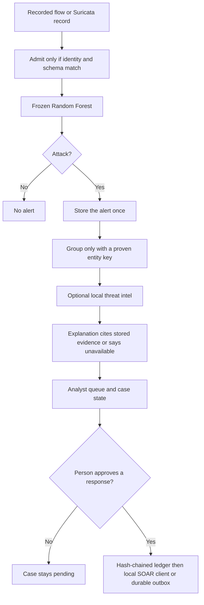

# ThreatFusion weekly owner report

**Date:** 2026-10-26  
**Branch:** `gemini/product-20260924`  
**Audience:** Muhammad Bilal  
**How to use this file:** open it whenever you want the picture, and at the end of a usage week. This chat cannot see the Cursor allowance meter. Say "usage is low" or "weekly report" and this file is rewritten before any new feature starts.

## What the product is

ThreatFusion is a single-laptop security assistant for a Tier-1 analyst. Recorded network flows go in. A frozen Random Forest decides whether a flow is an attack. The attack is stored once. Related flows are grouped only when their identity is proven. An explanation may speak only from stored evidence. A person approves any response. The model does not block a machine by itself.

## What is implemented

| Piece | State on 2026-10-26 |
|---|---|
| Frozen Random Forest alert decision | Built. Fusion with the autoencoder stays off. |
| Local mutual-TLS intake, replay protection, SQLite alerts | Built for the recorded demo path. |
| Analyst page with new / in review / closed / escalated | Built on the authenticated listener. |
| 30-second and 10-minute grouping when the entity key is proven | Built. Raw UNSW rows are not merged without that key. |
| Explanation that must cite evidence, and a follow-up that refuses unknown IPs, unknown techniques, and containment | Built. Local and deterministic. |
| Approval ledger with a hash chain, plus local n8n / TheHive / MISP clients | Built as local or simulated tools. Not a live company deployment. |
| Response-plane snapshot for the SOAR ledger, retrieval store, outbox, and dead letters | Built in uncommitted Milestone #39. |
| Boundary checks B0–B6, including a block when Python would import the old protected folder | Built in uncommitted Milestone #40. |
| Pretty walkthrough screen | The campaign queue reads stored flows. Sample incidents appear only if that request cannot be reached. |
| Live console panel | Built 2026-10-27. Ingest, analyst notes, local MITRE copilot, read-only drift, and a 6-node workbench that does not dispatch. |
| Campaign queue and Approve | Built 2026-10-27. Replay scores five recorded UNSW-NB15 study vectors with the frozen Random Forest. Approve writes a hash-chained `approved` row and does not execute containment. |

## How the product looks

There are two screens. The real one is the authenticated analyst page: a dark queue, a case detail, evidence badges that fail closed, and a form that changes case state. The other screen is the investor walkthrough. It looks like a finished console, and its queue is still sample data. A buyer should be shown the authenticated page plus one recorded case, not the sample walkthrough alone.

## Data flow

The autoencoder can reorder the queue. It cannot change the attack decision.

## What is left before a market-fit release

These are open on purpose. Closing them needs evidence, not another screen.

1. **TF-008.** Scores on data nobody used while choosing the model.
2. **TF-009.** At least 10 real people, timed on the same cases with and without ThreatFusion.
3. **TF-010.** The signed FAST-NUCES jury form.
4. **TF-011.** A live security feed and a live threat-intel source.
5. The walkthrough queue now reads stored flows. A buyer still needs one recorded case on the authenticated page, not only this local console.
6. Storage-backup sidecars were fixed on 2026-10-26: a WAL source no longer leaves `-wal` and `-shm` files in the snapshot. All 13 backup integration tests pass. A full crash rehearsal is still not done.
7. A repeated crash-and-restore rehearsal across alerts, analyst state, audit, and the SOAR ledger.

## Competitive position

Cortex XSIAM, Prophet, Dropzone, Charlotte AI, and Security Copilot are ahead on customer data, live tenancy, and distribution. ThreatFusion can be ahead on a narrower promise: every score on the screen is a frozen-model result or marked unavailable, private addresses stay on the machine, and no response runs without a person and a checkable approval record. That promise is true in the code. It is not yet a measured product, because TF-009 and TF-011 are open.

## Usage this week

Specialist bots were used from separate chats, which spent extra runs on the same reading. From this report forward, this chat calls one bot at a time. The full 1,500-test suite is not the default gate, because the last full run hung. The default gate is the whitespace check, the focused tests, the boundary preflight, and the repository-truth audit.

On 2026-10-26 the main chat ran those four gates on the uncommitted tree: whitespace clean, focused tests passed, boundary preflight B0–B6 GO, repository-truth audit 7/7 GO. The QA bot was then called from this same chat. It could read the B6 tests and confirmed TF-008 through TF-011 are open, but its session could not run commands, so its own scorecard is BLOCKED for lack of a run. That is a tooling limit, not a failed test. The next QA call has to be allowed to execute the four commands.
