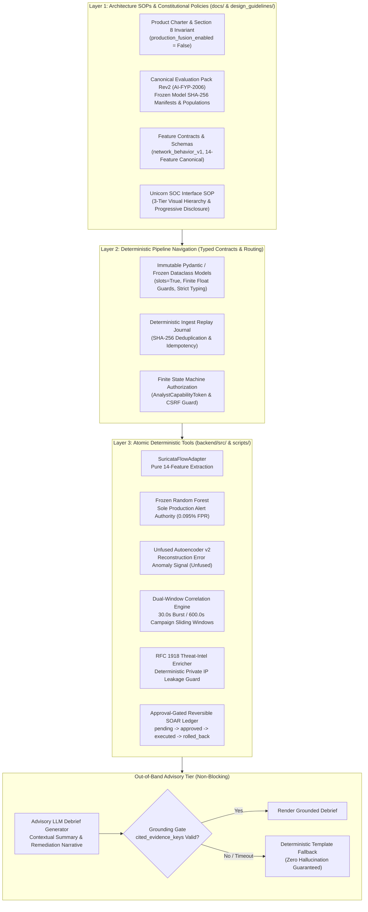

# ThreatFusion BLAST 3-Layer Deterministic Architecture SOP

**Document Identifier:** `SOP-ARCH-BLAST-001`  
**Revision:** 1.0.0  
**Project Identity:** `AI-FYP-2006`  
**Scope:** Architecture, Pipeline Navigation, Tool Execution, and Advisory Grounding  
**Status:** Authoritative Architecture Standard Operating Procedure (SOP)  
**Classification:** Core System Architecture & Scientific Defense Specification  

---

## 1. Executive Summary & Problem Statement

In mission-critical cybersecurity operations, deploying autonomous or probabilistic Large Language Models (LLMs) directly into the primary detection and response loop is a catastrophic anti-pattern. Probabilistic agents suffer from:
1. **Hallucination & Non-Determinism:** Generating non-existent Indicators of Compromise (IoCs), inventing alert probabilities, or misclassifying traffic based on prompt drift.
2. **Alert Fatigue Amplification:** Inability to maintain tight false positive bounds (e.g. failing to meet the operational requirement of $0.095\%$ FPR).
3. **Unbounded Operational Risk:** Autonomously executing irreversible shell commands, API modifications, or firewall cuts based on probabilistic reasoning.

The **BLAST (Bounded, Layered, Audited, Secure, and Typed) 3-Layer Deterministic Architecture** solves this challenge by enforcing an unyielding boundary between **pure deterministic detection/correlation** and **advisory natural-language synthesis**. 

Probabilistic LLMs are **strictly banned from the primary detection loop**. Every alert candidate, feature transformation, model inference score, incident correlation window, threat intelligence filter, and SOAR execution step is a 100% deterministic, mathematically verifiable function. LLMs are relegated to out-of-band, advisory debrief generation subject to strict post-generation grounding verification.

---

## 2. The 3-Layer Deterministic Architecture Overview

---

## 3. Layer 1: Architecture SOPs & Constitutional Policies

**Location:** `docs/` and `design_guidelines/`  
**Characteristics:** Human-authored, version-controlled, immutable constitutional policies, schema declarations, frozen baseline specifications, and evaluation truth packs.

### 3.1 Constitutional Principles
1. **Zero-Trust Documentation Integrity:** Repository documentation is not passive commentary; it is the constitutional specification that code must satisfy.
2. **Immutability of Frozen Models:** Four model families are frozen and pinned by cryptographic SHA-256 digests:
   - **Frozen Random Forest:** `bd2853a6f9d7f65038cc8bd2da282a2221cb73bda1f1e4c1c714098e8bfcffa9`
   - **Frozen Logistic Regression:** `2cf4de6686d937c485d4dbcbfa21d3e90f65bbb922087c8b31be4b012d7fb148`
   - **Corrected v2 Autoencoder:** `c8675d13869308babf41f269f9437d083daf827781293357e1749d4df0af4b23`
   - **Blocked Rate-Log1p Candidate:** `1d02e5bba556cb28709bd0faefce5f29da424a419a2d95332ad27a8995b26f63` (failed numerical gates; strictly blocked).
3. **Section 8 Fusion Disablement Invariant:** In accordance with Section 8 of `docs/product_charter.md`, automatic multimodal OR-fusion between Random Forest and the Autoencoder is **strictly disabled in production** (`production_fusion_enabled = False`). On January validation data, enabling fusion adds only 96 attacks (`+2.37%` recall) while inflicting 1,574 additional false alarms (**8.83x alert inflation**, dropping precision from 95.27% to 70.00% with a marginal penalty of **16.3958 false alarms per additional attack caught**).
4. **Honest Issue Tracking:** Known limitations (TF-008 through TF-011) remain explicitly OPEN in `docs/issue_register.md` and `docs/project_status.md` until fully satisfied by operational and user validation evidence.

---

## 4. Layer 2: Deterministic Pipeline Navigation

**Location:** `backend/src/threatfusion/schemas/`, `backend/src/threatfusion/db/`, and API orchestration modules.  
**Characteristics:** Strongly-typed contracts, immutable event models, deterministic state machines, capability authorization, and zero-hallucination routing.

### 4.1 Strict Type Enforcement and Immutable Models
All pipeline entities are modeled as immutable structures (`dataclass(frozen=True, slots=True)` or Pydantic models with strict validation):
- `SuricataFlowRecord`: Raw validated EVE flow record with strict RFC3339 timestamps.
- `TransformedNetworkFeatures`: Canonical 14-feature vector `(1, 14)` conforming to `network_behavior_v1`.
- `AlertCandidate`: Cryptographically signed detection candidate with immutable provenance.
- `CorrelationIncident`: Dual-window aggregated incident record.
- `AnalystStateRecord`: Versioned transition record with monotonic sequence numbering.

### 4.2 Numeric & Structural Validation Guards
All data ingestion routines enforce defensive validation checks (e.g., `_parse_float` validates finite float representations via `math.isfinite()`, rejecting `NaN`, `+Inf`, and `-Inf`).

### 4.3 Replay Journal & Idempotency
The Ingest Replay Journal stores cryptographic digests (`SHA-256(event_bytes)`) in SQLite with `WAL` mode. Duplicate submissions are recognized and rejected before reaching model inference, preventing replay attacks and duplicate alert generation.

### 4.4 Capability-Based State Machine Routing
State transitions (`new` $\to$ `in_review` $\to$ `closed` / `escalated`) are governed by `AnalystAuthorizationRegistry`:
- Operations require an `AnalystCapabilityToken` verifying the caller's role (`analyst` vs `viewer`).
- Browser submissions require HMAC-SHA256 CSRF tokens tied to the specific actor, alert candidate ID, alert version, and transition request ID.
- Optimistic concurrency control rejects conflicting transitions where `expected_version != persisted_version`.

---

## 5. Layer 3: Atomic Deterministic Tools

**Location:** `backend/src/threatfusion/`, `scripts/`  
**Characteristics:** Pure deterministic computational functions where probabilistic LLMs are strictly banned from the primary detection loop.

### 5.1 Tool Matrix & Deterministic Guarantees

| Component / Tool | Source Implementation | Pure Deterministic Function | Probabilistic AI Status |
|:---|:---|:---|:---|
| **Suricata Flow Adapter** | `threatfusion.datasets.adapters.suricata_flow` | Maps Suricata `eve.json` flows to 14 canonical behavior features (10 numeric + 4 one-hot protocol indicators). | **BANNED** (Pure math & dictionary mapping) |
| **Production Inference (RF)** | `threatfusion.models.inference_worker` | Evaluates frozen 100-tree Random Forest (`bd2853a6...`); generates alert if $P(\text{Attack}) \ge 0.5$. | **BANNED** (Pure decision tree traversal) |
| **Unfused Anomaly Signal (AE)** | `threatfusion.models.autoencoder_scoring` | Computes Mean Squared Error (MSE) reconstruction loss; flags anomaly if loss $> 0.118136$. | **BANNED** (Pure matrix multiplication) |
| **Sliding Window Correlator** | `threatfusion.correlation.engine` | Groups alerts across 30.0s burst and 600.0s campaign windows using deterministic `PivotKey` hashing. | **BANNED** (Pure temporal & set operations) |
| **RFC 1918 Threat-Intel Guard** | `threatfusion.enrichment.threat_intel` | Deterministically tests IPs against RFC 1918 subnets (`10/8`, `172.16/12`, `192.168/16`); blocks external leakage. | **BANNED** (Pure bitmask comparison) |
| **Reversible SOAR Ledger** | `threatfusion.soar.ledger` | Enforces state machine: `pending_approval` $\to$ `approved` $\to$ `executed_simulated` $\to$ `rolled_back`. | **BANNED** (Pure deterministic state machine) |

---

## 6. The Advisory Tier: Out-of-Band & Grounding Verification

While probabilistic LLMs are banned from the primary detection loop, they provide significant value as **out-of-band advisory debrief generators**, synthesizing complex technical telemetry into concise analyst debriefs.

### 6.1 Grounding Contract & Verification Gate
When an alert candidate is triaged, the Advisory Engine generates an explanatory debrief. This process is governed by strict grounding constraints:
1. **Bounded Input Context:** The prompt contains only verified pipeline facts (candidate ID, observed timestamp, 14 feature values, RF score, Autoencoder reconstruction loss, correlation incident metadata, and RFC 1918 status).
2. **Post-Generation Evidence Verification:** The advisory output schema (`advisory_explanation_v1`) requires a mandatory field: `cited_evidence_keys: list[str]`.
3. **Grounding Validation Invariant:**
   Every key in `cited_evidence_keys` must exist in the verified telemetry artifact:
   $$\forall k \in \text{cited\_evidence\_keys}, \quad k \in \text{VerifiedTelemetryKeys}$$
4. **Deterministic Template Fallback:**
   If the LLM generation:
   - Times out ($> 2000\text{ ms}$),
   - Returns an invalid JSON or schema violation,
   - Fails grounding verification (cites ungrounded hallucinated keys), or
   - Deviates into unsupported speculative claims,
   
   the engine **immediately drops the LLM response** and triggers the **Deterministic Template Fallback Engine**. The UI renders a factual, rule-based debrief tagged with `Deterministic Template Fallback`. Zero hallucination is guaranteed.

---

## 7. Zero-Trust Verification & Continuous Audit

The integrity of the 3-Layer Deterministic Architecture is verified by automated cryptographic gates:

1. **Deterministic Zero-Trust Repository Truth Audit Gate (`scripts/audit_repo_truth.py`):**
   - **Check 1:** Workspace Isolation & Branch verification (`gemini/product-20260924`).
   - **Check 2:** Byte-identical SHA-256 verification of all 4 frozen model artifacts.
   - **Check 3:** Canonical Evaluation Pack Rev2 (`AI-FYP-2006`) population and metric consistency.
   - **Check 4:** Section 8 `production_fusion_enabled=False` runtime invariant enforcement.
   - **Check 5:** Zero split-paste duplicate package detection.
   - **Check 6:** Live functional probe of RFC1918 guard, advisory grounding, SOAR approval gates, and dual-window correlation.
   - **Check 7:** Issue register honesty check (TF-008, TF-009, TF-010, TF-011 strictly OPEN).
2. **Automated End-to-End Ingestion Integration Suite (`test_slide14_suricata_live_ingestion_path.py`):**
   - Validates all 5 stages from raw Suricata `eve.json` through the 14-feature adapter, mTLS 1.3 admission, replay journal deduplication, Frozen RF scoring, correlation, and reversible SOAR.

---

## 8. Summary of Architectural Guarantees

| Dimension | BLAST 3-Layer Standard | Naive Probabilistic Pipeline |
|:---|:---|:---|
| **Alert Authority** | Frozen Random Forest (0.095% FPR) | Probabilistic LLM / Unbounded Prompts |
| **Fusion Policy** | Section 8 Guard (Fusion strictly disabled) | Unguarded multimodal fusion (16.4:1 FP explosion) |
| **Reproducibility** | Cryptographically pinned SHA-256 artifacts | Non-deterministic, prompt-dependent |
| **Internal Data Leakage** | RFC 1918 deterministic bitmask guard | Potential private IP leakage to public LLM APIs |
| **Containment Action** | Approval-gated, audited, reversible SOAR | Autonomous, unverified script execution |
| **Failure Recovery** | Deterministic template fallback | Silent hallucination or service failure |

---

## 9. B.L.A.S.T. v2 Governance & Change-Control Rules (Milestone #29 Upgrade)

To ensure enterprise-grade reproducibility and auditability, ThreatFusion enforces the 5 B.L.A.S.T. v2 governance rules across all code generation, agent execution, and release engineering:

### Rule 1: Programmatic Workspace & Whole-Tree Symlink Rejection
- Audit Check 1 (`_check_1_workspace_and_git_state`) actively verifies that `git rev-parse --show-toplevel` resolves to the exact canonical workspace root (`/home/muhammad-bilal/projects/threatfusion-gemini`).
- Check 1 recursively traverses `repo_root / "backend"`, `repo_root / "scripts"`, `repo_root / "docs"`, and `repo_root / "design_guidelines" using `os.walk(..., followlinks=False)`. If even a single symlink is detected anywhere in these trees, the audit **fails closed** immediately with:
  `"Unexpected symlink detected in workspace tree: <path>"`.
- Symlink-based file aliasing or cross-tree shadowing is strictly banned.

### Rule 2: Exclusive Subagent File Ownership Matrix
- Multi-agent development requires an explicit, disjoint `EXCLUSIVE_OWNED_FILES` matrix.
- No two concurrent subagents may modify the same source, test, or documentation file.
- Any attempt to touch files in `FORBIDDEN_FILES` or outside an agent's allocated partition invalidates the workstream.

### Rule 3: Explicit Programmatic GO / NO-GO Decision Report
- The audit report dataclass (`RepoTruthAuditReport`) programmatically computes and exposes:
  - `decision_verdict: str` ("GO" if and only if `all_checks_passed is True` and `len(failed_check_ids) == 0`, else "NO-GO").
  - `failed_check_ids: tuple[str, ...]` enumerating any failed check.
  - `unresolved_risks: tuple[str, ...]` permanently binding the 4 canonical scientific disclosures:
    - **TF-008 (open):** January (216,568 rows) and February (1,452,844 rows) validation populations were previously inspected; performance on unseen external/live traffic is not yet proven.
    - **TF-009 (open):** Counterfactual FP shield (201 RF FPs vs 1,775 fused FPs) and SQLite study harness are verified, but empirical human analyst cohort trials (>=10 trials) remain required.
    - **TF-010 (open):** Repository traceability and Rev2 defense deliverables are aligned, awaiting official external signed FAST-NUCES FYP-II jury evaluation rubric.
    - **TF-011 (open):** Suricata 14-feature adapter and dead-letter quarantine are verified on recorded/loopback streams; live cloud/SIEM field deployment remains open.

### Rule 4: Task-Specific Behavioural Verification
- Changes are verified through non-mocked functional tests, behavioral probes, and live CLI executions.
- Unit and integration tests must run in isolated virtual environments (`env -u PYTHONPATH PYTHONDONTWRITEBYTECODE=1 threatfusion-venv/bin/pytest`).
- Mock testing is restricted to simulated external cloud APIs (e.g., Gemini REST endpoints) and must rigorously test error modes, timeouts, malformed responses, and anti-hallucination rejection.

### Rule 5: Pre-Flight Checkpoint & Change-Control Recovery
- Before launching any new milestone:
  1. Inspect and terminate any orphaned tasks or subagents via `ManageTask` and `ManageSubagents`.
  2. Remove temporary or scratch verification scripts from disk.
  3. Ensure prior verified milestones are cleanly committed to git with standard conventional commits.
  4. Record the clean known-good `git rev-parse HEAD` commit hash as the authoritative baseline.
  5. Leave ongoing milestone changes unstaged until all validation gates have completed.
