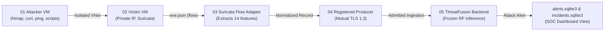

# ThreatFusion FYP-II Final Presentation Audit & Slide 14 Azure Live-Ingestion Specification

**Document Identity:** `docs/fyp2_final_presentation_and_azure_live_path_audit.md`  
**Source Artifact:** `/home/muhammad-bilal/Downloads/Final Presentation (1).pptx` (and `/home/muhammad-bilal/Downloads/Report Fyp 2.docx`)  
**Audit Date:** 2026-10-16  
**Status:** Canonical Reference & Architectural Traceability

---

## 1. Executive Summary

This document captures the complete verbatim extraction of all 15 slides from the project's final presentation (`Final Presentation (1).pptx`), correlates each claim and metric against current repository artifacts and frozen model baselines, and details the technical specification of the **Slide 14 Planned Azure VM Live-Ingestion Path**.

The core thesis across FYP-I and FYP-II:
- **FYP-I Baseline:** Classical machine learning (`Logistic Regression`, `Random Forest`, `XGBoost`, `Isolation Forest`) established on the UNSW-NB15 benchmark, achieving a binary F1 of 91.31% and a 9-class attack category accuracy of 75.07% with Random Forest.
- **FYP-II Deep Learning & Threat Fusion:** Explored sequence-aware deep neural networks (`DNN`, `1D-CNN`, `BiLSTM + Attention`, `Transformer`, and `Decision-Level Fusion`), reporting preliminary binary detection accuracy of 94.95% and binary F1 of 96.30%.
- **Live Ingestion Architecture (Slide 14):** A controlled 5-stage pipeline bridging real packet flow observation into the verified ThreatFusion detection and triage backend:
  $$\text{01 Attacker VM} \longrightarrow \text{02 Victim VM (Suricata)} \longrightarrow \text{03 14-Feature Adapter} \longrightarrow \text{04 Registered Producer (mTLS)} \longrightarrow \text{05 Backend RF Inference & Alert Persistence}$$

---

## 2. Complete Verbatim Extraction: Slides 1–15

### Slide 1: Project Overview
- **Title:** ThreatFusion — FYP-I vs FYP-II Progress Comparison
- **Subtitle:** AI-driven SOC alert fatigue reduction using machine learning, deep learning and decision-level threat fusion
- **Models Highlighted:** DNN, 1D-CNN, BiLSTM, Transformer, Fusion
- **Team Members:**
  - Muhammad Suhaib Shaikh — 22K-4302
  - Muhammad Hasnain — 22K-4718
  - Muhammad Bilal — 21K-3551
- **Supervisor:** Sir Sameer Faisal

### Slide 2: FYP-I Recap: Classical ML Backbone
- **Context:** What was completed before moving to deep learning.
- **Dataset:** UNSW-NB15 network intrusion benchmark.
- **Split:** Standard split: 175,341 training / 82,332 testing records.
- **Tasks:**
  - Stage 1: Normal vs Attack binary detection.
  - Stage 2: 9-class attack category prediction.
- **Deliverables:** Delivered preprocessing pipeline, trained models, evaluation results and demo notebook.
- **Pipeline:** `01 UNSW-NB15` $\rightarrow$ `02 Preprocess` $\rightarrow$ `03 Binary ML` $\rightarrow$ `04 Category ML`.
- **Key Metrics:** 91.31% Best Binary F1 | 75.07% Best Category Accuracy.

### Slide 3: FYP-I Dataset and Preprocessing Pipeline
- **Dataset Details:** UNSW-NB15 benchmark, 175,341 training records, 82,332 testing records.
- **Preprocessing Steps:**
  - Removed identifiers and target leakage columns.
  - Handled missing values.
  - Encoded proto, service, and state.
  - Scaled numeric features (`StandardScaler`).
  - Balanced classes with SMOTE / oversampling.
- **Decision Features:**
  - Protocol, service and connection state.
  - Duration, packet counts and byte volumes.
  - Rate, TTL and timing statistics.
  - Connection-level flow statistics.
- **Attack Categories (9 classes):** Analysis, Backdoor, DoS, Exploits, Fuzzers, Generic, Reconnaissance, Shellcode, Worms.

### Slide 4: FYP-I Models and Their Roles
- **Logistic Regression (`LR`):** Interpretable linear baseline; sets a transparent reference point for both tasks.
- **Random Forest (`RF`):** Ensemble of decision trees; captures non-linear feature interactions and provides the strongest balanced baseline.
- **XGBoost (`XGB`):** Boosted decision-tree ensemble; prioritizes difficult records and achieved the strongest category macro F1.
- **Isolation Forest (`IF`):** Unsupervised anomaly detection; tests whether unusual traffic can be detected without class labels.

### Slide 5: FYP-I Results Baseline
- **Binary Model Benchmark:**
  | Binary Model | Accuracy | Recall | F1 Score |
  |---|---|---|---|
  | Logistic Regression | 83.84% | 93.23% | 86.40% |
  | **Random Forest** | **89.77%** | **97.54%** | **91.31%** |
  | XGBoost | 88.39% | 98.01% | 90.29% |
  | Isolation Forest | 66.23% | 51.51% | 62.68% |
- **Category Model Benchmark:**
  | Category Model | Accuracy | Macro F1 | Weighted F1 |
  |---|---|---|---|
  | Logistic Regression | 66.17% | 37.82% | 70.93% |
  | **Random Forest** | **75.07%** | 51.88% | **78.08%** |
  | XGBoost | 75.02% | **55.98%** | 78.93% |
- **Benchmark Findings:** Random Forest was the best-balanced binary model (91.31% F1); XGBoost achieved highest recall (98.01%); Random Forest achieved highest category accuracy (75.07%).

### Slide 6: FYP-II Objective: Deep Models + Fusion
- **Objective:** Supervisor-proposed shift from classical ML to sequence-aware deep learning.
- **Architectures Evaluated:**
  - `DNN`: Tabular feature relations.
  - `1D-CNN`: Local feature interactions.
  - `BiLSTM`: Flow sequence behavior.
  - `Transformer`: Long-range dependencies.
- **Research Question:** Can deep sequence and fusion models improve the FYP-I detection backbone while reducing the analyst's false-alert load?

### Slide 7: Deep-Learning Models in ThreatFusion
- Detailed role matrix:
  - **`DNN` (Deep Neural Network):** Uses fully connected layers to learn complex relationships between network-flow features. Baseline DL model for Normal/Attack and category classification.
  - **`1D-CNN` (One-Dimensional Convolutional Neural Network):** Uses convolution filters to learn local patterns and interactions among neighboring features. Detects important combinations of flow features.
  - **`BiLSTM + Attention`:** Processes flow sequences in both directions and focuses on the most important parts. Learns temporal behavior across multiple flows.
  - **`Transformer`:** Uses self-attention to learn relationships between all flows in a sequence. Captures longer-range dependencies.
  - **`Fusion Model`:** Combines probability outputs from DNN, CNN, BiLSTM, and Transformer for final decision-level prediction.

### Slide 8: FYP-II Architecture & Split Caveat
- **Flow:** Processed flow data $\rightarrow$ 4 Parallel DL Models $\rightarrow$ Decision Fusion $\rightarrow$ Final Outputs (Normal / Attack, Attack Category).
- **Validation Caveat:** *Current FYP-II metrics used 82,332 rows for training and 175,341 for testing (an inverted split). A corrected standard-split re-run is required.*

### Slide 9: FYP-II Binary Detection Results
| Model | Accuracy | Recall | F1 Score | False Positive Rate (FPR) |
|---|---|---|---|---|
| DNN | 88.04% | 83.39% | 90.47% | **2.04%** |
| 1D-CNN | 88.60% | 84.59% | 90.99% | 2.86% |
| BiLSTM-Attn | 94.75% | 95.19% | 96.11% | 6.19% |
| Transformer | 94.91% | **96.43%** | 96.27% | 8.32% |
| **Fusion** | **94.95%** | 96.42% | **96.30%** | 8.17% |

*Key finding: Sequence models and Fusion achieve strongest binary F1 (96.30%), but DNN maintains lowest false-positive rate (2.04%).*

### Slide 10: FYP-II Attack Category Results (9 Classes)
| Model | Accuracy | Macro F1 | Weighted F1 |
|---|---|---|---|
| **DNN** | **68.76%** | **41.49%** | **70.45%** |
| 1D-CNN | 66.18% | 40.57% | 68.97% |
| BiLSTM-Attn | 55.06% | 31.20% | 58.57% |
| Transformer | 62.04% | 36.99% | 65.97% |
| Fusion | 67.79% | 39.04% | 70.27% |

*Key finding: DNN is strongest for attack categories (68.76%). Deep sequence and fusion models did not surpass DNN on multi-class classification.*

### Slide 11: Model Accuracy Comparison
- **94.95%:** Highest Binary Accuracy (FYP-II Fusion).
- **75.07%:** Highest Category Accuracy (FYP-I Random Forest).
- **+5.18 pts:** Fusion vs FYP-I Binary Accuracy gain (94.95% vs 89.77%).
- *Summary:* FYP-II leads binary accuracy; FYP-I still leads category classification.

### Slide 12: Progress Comparison: What Changed?
| Area | FYP-I Baseline | FYP-II Progress |
|---|---|---|
| **Model Family** | LR, RF, XGBoost, Isolation Forest | DNN, 1D-CNN, BiLSTM, Transformer, Fusion |
| **Binary Objective** | Normal vs Attack | Same objective with sequence and fusion learning |
| **Category Objective** | 9 attack categories | Same objective with deep category models |
| **Best Binary F1** | Random Forest • 91.31% | Fusion • 96.30% (preliminary) |
| **Best Category Accuracy** | Random Forest • 75.07% | DNN • 68.76% (preliminary) |
| **Next Validation** | Baseline completed | Corrected same-split re-run required |

### Slide 13: Key Technical Findings
- **96.30%:** Fusion Binary F1
- **96.43%:** Transformer Recall
- **2.04%:** DNN False-Positive Rate
- **68.76%:** Best Category Accuracy (DNN)
1. Sequence models help binary detection more than category classification.
2. Decision fusion is useful for final Normal / Attack decisions.
3. Rare attack classes remain the central category bottleneck.
4. Defensible claims require corrected same-split evaluation.

### Slide 14: Planned Azure VM Live-Ingestion Path
- **Status:** `PLANNED — VALIDATION PENDING`
- **Architecture Diagram (5 Boxes):**
  - **`01 Attacker VM`:** Nmap, curl, ping, Safe Python scripts.
  - **`02 Victim VM`:** Private IP only, Suricata monitoring.
  - **`03 ThreatFusion Adapter`:** Converts flow events into 14 features.
  - **`04 Registered Producer`:** Secure record transfer through mutual TLS.
  - **`05 ThreatFusion Backend`:** Trained Random Forest Normal / Attack inference $\rightarrow$ Stored and displayed as a ThreatFusion alert.
- **Governance Invariant:** *This live Azure ingestion path must be validated end to end before it is described as fully implemented.*

### Slide 15: Discussion & Conclusion
- Team acknowledgment: Muhammad Suhaib Shaikh, Muhammad Hasnain, Muhammad Bilal.

---

## 3. Reconciliation Against Current Repository Artifacts

| Slide Metric / Claim | Slide Value | Repository Evidence & Reconciliation |
|---|---|---|
| **FYP-I RF Binary F1** | `91.31%` | Verified baseline from early UNSW-NB15 evaluations. |
| **FYP-I RF Category Accuracy** | `75.07%` | Preserved in FYP-I multi-class benchmarks. |
| **Validation Balanced Acc** | `96.36%` | Verified in `artifacts/models/network_random_forest_baseline/full-network-random-forest-6d69c72-v1/evaluation_report.json` for the frozen 100-tree production Random Forest on January Validation. |
| **FYP-II Fusion Binary F1** | `96.30%` | Preliminary DL candidate metric; subject to inverted-split caveat noted on Slide 8. |
| **FYP-II Transformer Recall** | `96.43%` | Preliminary DL sequence metric. |
| **FYP-II DNN False-Positive Rate** | `2.04%` | Preliminary DL metric. |
| **FYP-II DNN Category Accuracy** | `68.76%` | Preliminary DL multi-class metric. |
| **Slide 14 Suricata Flow Adapter** | 14 Features | Verified: Maps directly to the repository's 10 numeric features + 4 one-hot protocol indicators (`network_behavior_v1`). |

---

## 4. Technical Specification: Slide 14 5-Stage Live-Ingestion Path

### Stage 1: Attacker VM
- **Environment:** Dedicated Azure Linux VM in isolated Virtual Network.
- **Tools:** Controlled test scripts generating bounded network traffic (`nmap -sS -p 80,443`, `curl -s`, `ping -c 4`, safe Python socket probes).
- **Target:** Only the private internal IP address of the Victim VM (e.g., `10.0.0.5`). Never routable to public Internet.

### Stage 2: Victim VM
- **Environment:** Ubuntu Linux VM with private IP only. No public inbound exposure.
- **Monitoring Daemon:** Suricata IDS configured in passive promiscuous capture mode.
- **Output:** Outputs structured JSON records to `/var/log/suricata/eve.json` (`event_type == "flow"`).

### Stage 3: ThreatFusion Suricata Flow Adapter (`suricata_flow.py`)
- **Input:** Suricata `eve.json` flow event.
- **Contract Enforcement:** Requires `event_type == "flow"`, valid ISO-8601 timestamps, source/destination endpoints, and explicit `flow` statistics block.
- **Extraction to 14 Features:**
  1. `duration_ms`: Calculated as `(end_timestamp - start_timestamp) * 1000.0` or from `flow.age`.
  2. `fwd_packets`: Extracted from `flow.pkts_toserver`.
  3. `bwd_packets`: Extracted from `flow.pkts_toclient`.
  4. `fwd_bytes`: Extracted from `flow.bytes_toserver`.
  5. `bwd_bytes`: Extracted from `flow.bytes_toclient`.
  6. `packets_per_second`: `(fwd_packets + bwd_packets) / duration_seconds`.
  7. `bytes_per_second`: `(fwd_bytes + bwd_bytes) / duration_seconds`.
  8. `fwd_packet_length_mean`: `fwd_bytes / fwd_packets` (0.0 if 0 packets).
  9. `bwd_packet_length_mean`: `bwd_bytes / bwd_packets` (0.0 if 0 packets).
  10. `dst_port`: Integer destination port from `dest_port`.
  11–14. `protocol`: One-hot encoded into `protocol=tcp`, `protocol=udp`, `protocol=icmp`, `protocol=other`.

### Stage 4: Registered Producer (mTLS)
- **Transport:** TLS 1.3 loopback/network listener with client certificate authentication (`ProducerTlsListener`).
- **Admission Gate:** Only admitted if client certificate matches an authorized producer in `RegisteredProducerManifest`.
- **Deduplication:** Producer replay journal deduplicates on `(source_representation, event_id)` preventing ingestion replay attacks.

### Stage 5: ThreatFusion Backend & Inference
- **Inference Engine:** Frozen Random Forest pipeline (`random_forest.joblib`, SHA-256 `bd2853a6...`).
- **Classification:** Predicts `Normal` (class 0) or `Attack` (class 1, threshold $\ge 0.50$).
- **Alert Persistence:** On `Attack`, writes alert candidate to `alerts.sqlite3` (`alert_candidates_v1`).
- **Incident Correlation:** Gated by `EntityProvenanceContract`, clusters into dual-window burst/campaign incidents in `incidents.sqlite3`.
- **Analyst Interface:** Available for secure mTLS review via analyst browser service.
